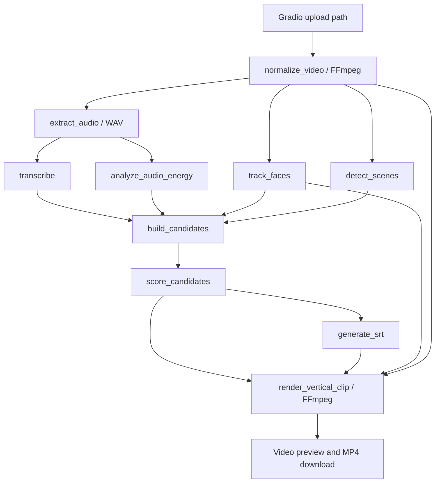

# 0. Repo inventory

Audit date: 30 September 2026. Source of truth: the uploaded `AttentionX.zip`; paths below are relative to its `AttentionX/` root. The separate uploaded `Agent.md` supplies this audit's requirements. **The product is a Python/Gradio automatic clip generator, not an existing timeline editor.** New paths, models, events, and fields below are explicitly proposed. The uploaded source has not been rewritten.

The archive contains **267 entries: 201 files and 66 directory entries**, totaling **24,468,026 uncompressed bytes**, including development artifacts. All 51 Python files were read and parsed; all 57 Markdown files, both shell scripts, dependency declarations, and the fixture JSON were reviewed. Media containers were probed locally; this is not a claim that every minute of included media was manually watched. `repo_inventory.csv` and `repo_inventory.json` in the companion pack enumerate all 201 original files with role, size, and SHA-256. VCS internals and generated bytecode are inventoried, not treated as executable product features.

| Role | Files | Exact locations |
|---|---:|---|
| App entry and UI | 1 | `app.py` |
| Runtime models | 3 | `models/__init__.py`, `models/schemas.py`, `models/settings.py` |
| Runtime services | 12 | `services/__init__.py`, `services/ingest.py`, `services/transcribe.py`, `services/audio_features.py`, `services/face_track.py`, `services/scene_detect.py`, `services/segment_builder.py`, `services/scorer.py`, `services/captions.py`, `services/render.py`, `services/style_profile.py`, `services/gemini_hooks.py` |
| Runtime utilities | 4 | `utils/__init__.py`, `utils/ffmpeg_utils.py`, `utils/io_utils.py`, `utils/time_utils.py` |
| Test scaffolding | 3 | `tests/conftest.py`, `tests/support/__init__.py`, `tests/support/media_factory.py` |
| Unit test modules | 8 | `tests/unit/test_app.py`, `test_audio_features.py`, `test_captions.py`, `test_ingest.py`, `test_io_utils.py`, `test_scorer.py`, `test_segment_builder.py`, `test_time_utils.py` within `tests/unit/` |
| Integration test modules | 7 | `tests/integration/test_app_pipeline.py`, `test_audio_analysis_pipeline.py`, `test_face_track_pipeline.py`, `test_gate_runner.py`, `test_ingest_pipeline.py`, `test_render_pipeline.py`, `test_scene_detection_pipeline.py` within `tests/integration/` |
| Validation scripts | 12 | `scripts/gate1_smoke.py`, `gate2_test.py`, `gate3_transcription.py`, `gate4_audio_analysis.py`, `gate5_face_tracking.py`, `gate6_scene_detection.py`, `gate7_ranking.py`, `gate8_captions.py`, `gate9_render.py`, `gate10_ui.py`, `gate_common.py`, `run_all_gates.py` within `scripts/` |
| Fixture acquisition | 1 | `scripts/fetch_test_video.py` |
| Test/deploy shell scripts | 2 | `run_tests.sh`, `deploy_to_hf.sh` |
| Configuration | 3 | `requirements.txt`, `packages.txt`, `.gitignore` |
| Documentation | 57 | `README.md`; `SPECs/agent.md`, `SPECs/techstack.md`, `SPECs/roadmap.md`; 53 files across the 14 `Features/F01-*` through `Features/F14-*` folders |
| Media/generated artifacts | 15 | `2026-04-18 21-55-55.mkv`; `data/test/`; three old `data/temp/` sessions; two old `data/outputs/` sessions; empty directory markers |
| VCS internals | 29 | Archive's Git metadata; excluded from runtime analysis |
| Runtime caches | 44 | Python bytecode and pytest cache; excluded from product feature counts |

There are **20 runtime Python files, 17 nonempty**, including app entry; **13 Python scripts**; and **18 test Python files**. `services/` has 11 functional/stub modules plus its initializer. The current service files are ordinary in-process Python modules, not network microservices.

Declared dependencies, not inferred installed versions:

| Dependency | Archive declaration | Evidence and implication |
|---|---|---|
| Python | No explicit runtime pin | Python 3.12 bytecode exists in the archive; feature notes also name 3.12. No `pyproject.toml` or Python version file establishes a reproducible interpreter. |
| Gradio | `>=5.0,<6.0` | `requirements.txt`; `README.md` separately sets Spaces `sdk_version: 5.50.0`. These are not a complete lock. |
| faster-whisper | `>=1.0.3` | `requirements.txt`; `services/transcribe.py` forces CPU/int8 and `base` by default. |
| librosa | `>=0.10.2` | RMS analysis in `services/audio_features.py`. |
| MediaPipe | `>=0.10.14` | Legacy `mp.solutions` compatibility fallback in `services/face_track.py`. |
| PySceneDetect | `scenedetect[opencv]>=0.6.4` | `ContentDetector` in `services/scene_detect.py`. |
| OpenCV | `opencv-python-headless>=4.9.0.80` | Face sampling; PySceneDetect's OpenCV backend. The extra can pull another OpenCV distribution, so resolve to one `cv2` provider. |
| NumPy / SciPy | `numpy>=1.24.0,<2.0`; `scipy>=1.11.0` | Not fully locked. Do not dismiss incompatible wheel requirements as harmless warnings, as the old F01 completion note does. |
| Generative SDK | `google-generativeai>=0.8.0` | No runtime use; Gemini implementation is a stub. |
| Development/fixture tools | `datasets>=2.18.0`, `yt-dlp>=2024.1.0`, `pytest>=8.0.0` | Download script imports pandas and `huggingface_hub` transitively rather than declaring its own complete dependencies. |
| System binaries | `ffmpeg` | `packages.txt`; wrappers also require `ffprobe` on PATH. Verify `libx264`, AAC, `subtitles`/libass at startup. |
| Node / browser WASM / JS frontend | **NOT PRESENT / not required** | No `package.json`, web worker, ffmpeg.wasm, React/Svelte/Electron project, or browser-side frame loop. |

No dependency lockfile, Dockerfile, custom REST API, durable job queue, analysis cache, image/audio/text import workflow, OCR engine, Jev integration, or MediaMetadata contract exists in this archive.

Production-minded pieces are argument-list subprocess calls, domain exceptions, UUID output isolation, stage functions, resource cleanup, and ffprobe checks. The overall app remains a prototype: dependency/import behavior, resource admission, durable state, semantic accuracy, and failure isolation are not production contracts.

# 1. What this product is today

`app.py:build_demo()` exposes one `gr.Video` source upload, optional reference files, a Generate Clips button, three result videos, a files download component, and a status textbox. `app.py:run_pipeline()` normalizes the whole upload, extracts WAV, transcribes it, measures RMS, samples faces, detects cuts, creates transcript-derived candidate windows, scores them with handwritten heuristics, writes SRT, and renders up to three 720×1280 H.264/AAC MP4s. This is automatic repurposing; users cannot edit in/out points, rearrange shots, edit captions, or maintain a project timeline in the supplied code.

Video with an audio stream is first-class. `services/ingest.py:normalize_video()` explicitly rejects video without audio **after** transcoding. `services/transcribe.py:transcribe()` rejects an empty transcript. As a result, even the segment builder's empty-transcript fallback is normally unreachable through the app's no-speech path. Audio-only, still images, SRT/VTT, metadata generation, asset search, and an inspector are **NOT PRESENT**. Reference uploads appear in the UI, but `services/style_profile.py:build_style_profile()` always returns `None`. `services/gemini_hooks.py:generate_hook()` always returns empty strings and is not called by `app.py`.

Uploads are Gradio-managed filesystem paths. `utils/io_utils.py:make_session_dirs()` creates a UUID directory per submission, not a durable browser-session project. Normalized media, WAV, temporary cut MP4s, and SRT live in `data/temp/{uuid}/`; `app.py` deletes that directory in `finally`. Final MP4s remain in `data/outputs/{uuid}/`, with no expiry policy in code. There is no blob store or in-memory video representation. Lists of transcript, RMS, face coordinates, candidates, and scores live only in the Python request's local variables.

`data/test/test_video_meta.json` is dataset-download metadata, **not project JSON**. It contains a video ID, dataset caption/topic, source time strings, and a developer-local path. Nothing in the runtime reads it to drive analysis or editing. Its descriptive caption is not OCR/ASR ground truth.

Local probing found the two fixture MP4s are identical: **21.667 seconds, 360×640, H.264, 24 fps, AAC stereo**. Thus the default demo sample is portrait despite the horizontal-video marketing. The archive also contains an 83.6-second 1920×1080 H.264/AAC MKV recording, three old normalized/WAV sessions, and two identical 720×1280 output clips. Existing outputs demonstrate stored container properties; they do not prove current end-to-end speech accuracy or a successful public deployment.

Visible performance costs come directly from `app.py:run_pipeline()`, `services/ingest.py:normalize_video()`, `services/face_track.py:track_faces()`, `services/scene_detect.py:detect_scenes()`, and `services/transcribe.py:transcribe()`: unconditional full-video transcode; sequential whole-source passes; full-frame decoding even when the face detector runs only at sample intervals; a fresh Whisper model for every run; and no reuse when the same file is submitted again. Gradio's queue keeps the browser responsive but offers one generation slot; it is not a separate durable analysis worker.

# 2. Code breakdown

Each module entry describes existing code and names precise **proposed** extension points. Those hooks do not exist today.

### `app.py`

- Responsibility and inputs/outputs: Gradio payload → paths; source + refs → `(clip1,clip2,clip3,download_files,status)`
- Key types/functions: `_coerce_file_paths`, `run_pipeline`, `build_demo`, `launch_demo`
- Side effects and coupling: Imports every core stage eagerly; creates directories and demo at import; serial analysis + rendering; launches queued app at `0.0.0.0:7860` by default
- Quality: **Prototype.**
- Exact proposed extension points: Add import/Analyze callbacks in `build_demo`; introduce a new project `gr.State`; move orchestration out of `run_pipeline`; preserve its public return tuple via an adapter. Do not pretend an existing asset store can hold metadata.

### `models/schemas.py`

- Responsibility and inputs/outputs: Plain dataclasses for stage outputs
- Key types/functions: `TranscriptSegment`, `EnergyPeak`, `RMSCurve`, `FaceTrack`, `CandidateSegment`, `StyleProfile`, `ScoredSegment`; exceptions `NormalizationError`, `AudioExtractionError`, `TranscriptionError`, `AudioAnalysisError`, `SceneDetectionError`, `RenderError`
- Side effects and coupling: No I/O; every service shares these types. Type hints do not validate values or enforce invariants at runtime.
- Quality: **Useful foundation, insufficient contracts.**
- Exact proposed extension points: Keep existing dataclasses for compatibility; add new `models/media_metadata.py` and `models/project.py`. Extend face samples with explicit detection mask/score, not coordinate sentinels.

### `models/settings.py`

- Responsibility and inputs/outputs: Hardcoded runtime defaults: base Whisper, 2-fps faces, scene threshold 27, 5–20s candidates, top three, weights
- Key types/functions: `Settings`, `settings`
- Side effects and coupling: Mutable module singleton shared by app/scorer; `whisper_beam_size`, `face_confidence`, and `max_upload_mb` do not govern their corresponding behaviors
- Quality: **Fragile configuration.**
- Exact proposed extension points: Add validated analysis flags, model identities, language policy, budgets, privacy, and limits; read configuration at startup, snapshot it per job.

### `utils/ffmpeg_utils.py`

- Responsibility and inputs/outputs: FFmpeg args → side effects; media path → selected stream facts/dimensions/duration
- Key types/functions: `run_ffmpeg`, `probe_streams`, `get_video_dimensions`, `get_duration`
- Side effects and coupling: Blocking subprocesses, captured stderr, no timeout/cancel/process quotas. `probe_streams` omits rate, rotation, format, color, and timestamps.
- Quality: **Solid argument-list baseline, fragile lifecycle.**
- Exact proposed extension points: Reuse command construction conventions; add a bounded process runner and `probe_asset` that reads original streams once. Do not mix measured loudness into ffprobe metadata.

### `utils/io_utils.py`

- Responsibility and inputs/outputs: Optional base directories → absolute unique temp/output paths; directory → best-effort recursive deletion
- Key types/functions: `make_session_dirs`, `cleanup_temp`
- Side effects and coupling: UUID creation, mkdir, `shutil.rmtree(ignore_errors=True)`
- Quality: **Sound isolation, incomplete retention.**
- Exact proposed extension points: Split disposable session work from a persistent managed asset/cache root; keep `cleanup_temp` from deleting imported originals or shared cache entries; introduce quota/TTL cleanup.

### `utils/time_utils.py`

- Responsibility and inputs/outputs: Seconds → rounded `HH:MM:SS,mmm`
- Key types/functions: `fmt_srt_time`
- Side effects and coupling: No I/O; used by captions
- Quality: **Solid small utility.**
- Exact proposed extension points: Preserve; validate nonnegative finite times before calling and cap caption ranges at clip duration.

### `services/ingest.py`

- Responsibility and inputs/outputs: Input path → H.264/AAC MP4 with even dimensions; normalized MP4 → mono 22,050-Hz WAV
- Key types/functions: `normalize_video`, `extract_audio`
- Side effects and coupling: Whole-source FFmpeg transcode and audio extraction; stream verification; normalization requires both video and audio
- Quality: **Functional video-with-audio MVP.**
- Exact proposed extension points: Insert probe/hash registration *before* normalization; separate modality admission from proxy/render prep; allow silent video and independent audio/image/text ingest. Keep 22.05-kHz RMS if needed; use 16-kHz mono ASR proxy separately.

### `services/transcribe.py`

- Responsibility and inputs/outputs: WAV + model size → list of `(start,end,text)`
- Key types/functions: `transcribe`
- Side effects and coupling: New CPU/int8 Whisper model each call; downloads/cache possible; consumes generator; empty list is fatal
- Quality: **Functional adapter, accuracy unverified.**
- Exact proposed extension points: Load once per worker; add VAD/optional invocation, language/configuration, word timestamps, raw ASR diagnostics and empty-speech status; preserve original-clock timestamps. Never synthesize transcript with Jev.

### `services/audio_features.py`

- Responsibility and inputs/outputs: Full mono WAV → normalized RMS curve and percentile peak intervals
- Key types/functions: `analyze_audio_energy`, `_merge_contiguous_windows`
- Side effects and coupling: Import creates `/tmp/attentionx-numba`; librosa loads whole waveform; NumPy analysis; app discards returned RMS curve
- Quality: **Usable heuristic, not speech/emotion detector.**
- Exact proposed extension points: Retain RMS as one measurement; add original-channel EBU R128/true peak/silence, streaming audio descriptors, optional ASR gating. One-frame runs can have equal start/end and need duration semantics.

### `services/face_track.py`

- Responsibility and inputs/outputs: Video path + sample FPS → parallel timestamp/center arrays and global visibility/stability
- Key types/functions: `track_faces`, `_detect_face_center`, `_compute_stability`, `_build_detector`
- Side effects and coupling: OpenCV decodes all frames; MediaPipe detection runs intermittently; first detection chosen, not a verified dominant speaker; missing legacy API silently disables detector
- Quality: **Fragile perception/crop contract.**
- Exact proposed extension points: Feed shared FFmpeg-produced sampled frames; retain per-sample detection and confidence; make unavailable detector explicit. Consider YuNet only as an optional small face-location extractor. No face identity recognition.

### `services/scene_detect.py`

- Responsibility and inputs/outputs: Normalized video + threshold → scene-start seconds; `[0.0]` for uncut video
- Key types/functions: `detect_scenes`
- Side effects and coupling: PySceneDetect/OpenCV decoding; only open failure is wrapped in `SceneDetectionError`
- Quality: **Functional cut routine, limited coverage.**
- Exact proposed extension points: Preserve legacy boundary adapter for `build_candidates`; new analyzer yields `[t0,t1)` scenes with PTS, cut metrics, and end boundary. Share reduced-resolution FFmpeg decode and cache.

### `services/segment_builder.py`

- Responsibility and inputs/outputs: ASR/peaks/face/cuts/duration → candidate dataclasses
- Key types/functions: `build_candidates`, `_chunk_transcript`, `_energy_in_window`, `_face_in_window`, `_scene_coherence`, `_snap_to_scene`, `_fallback_candidates`
- Side effects and coupling: No I/O; greedy transcript grouping; snap only start; max overlapping energy; face visibility guessed from noncenter coordinates
- Quality: **Toy selection logic with reproduced bounds defects.**
- Exact proposed extension points: Fix chunking/snap/overlap invariants; add `asset_id`, source ranges, context references through a new clip model; consume cached facts and optional typed keep/value decisions.

### `services/scorer.py`

- Responsibility and inputs/outputs: Candidates + optional style → top N scored segments with breakdown
- Key types/functions: `score_candidates`, `_transcript_score`, `_style_score`
- Side effects and coupling: No I/O; reads global weights; English regex, punctuation, word count, filler and capitalization heuristics
- Quality: **Transparent baseline, not semantic quality.**
- Exact proposed extension points: Preserve behind a baseline flag and normalize active weights; add an optional calibrated decision scorer alongside it. Keep measured energy/face/scene values separate from model probabilities.

### `services/captions.py`

- Responsibility and inputs/outputs: Selected segment → temporary SRT file
- Key types/functions: `generate_srt`
- Side effects and coupling: UTF-8 disk write; relative timestamps; overlap prevention by postponing subsequent starts; truncates wrap output to two lines
- Quality: **Fragile, loses text.**
- Exact proposed extension points: Split long utterances into multiple cues; constrain times to clip bounds; preserve all tokens and language-aware reading speed; make SRT/VTT import/export first-class.

### `services/render.py`

- Responsibility and inputs/outputs: Normalized path + score/SRT/face → final MP4 path
- Key types/functions: `render_vertical_clip`, `_mean_face_cx`, `_verify_output`
- Side effects and coupling: Stream-copy cut, then crop/scale/subtitle transcode; static mean horizontal anchor; ffprobe verifies H.264/audio/aspect but not expected dimensions, exact content range, or audio codec
- Quality: **Working constrained render path.**
- Exact proposed extension points: Fix narrow/tall inputs, escaping, empty subtitles, exact seek and codec/duration assertions; render only selected source range in one decode/encode; introduce render recipe and proxy references.

### `services/style_profile.py`

- Responsibility and inputs/outputs: Reference paths → always `None`
- Key types/functions: `build_style_profile`
- Side effects and coupling: No media processing; called conditionally by app
- Quality: **Stub.**
- Exact proposed extension points: Freeze/hide until implemented; later derive duration/face/OCR-caption density from cached reference assets. `1/duration` is not words/second.

### `services/gemini_hooks.py`

- Responsibility and inputs/outputs: Segment/index → always `("", "")`
- Key types/functions: `generate_hook`
- Side effects and coupling: No network or environment lookup in current stub; no app call site
- Quality: **Unused stub.**
- Exact proposed extension points: Freeze/remove dependency from core; L5 can later generate text from verified structured evidence using a separately configured provider. Do not implement old model names from feature pseudocode without verification.

## Tooling, tests and specifications


| Exact path | What it actually verifies / does | Limitation |
|---|---|---|
| `tests/conftest.py`, `tests/support/media_factory.py` | Deterministic sine/testsrc/color-cut fixtures, dataclass fixtures, SRT parser, ffprobe helpers | Synthetic media; no labeled natural speech, OCR, or moving speaker benchmark |
| `tests/unit/test_ingest.py`, `test_app.py` within `tests/unit/` | Mocked ingest/app wiring; labels and successful tuple shape | Cannot prove codecs from fake MP4 bytes or actual ASR |
| `tests/unit/test_captions.py`, `test_segment_builder.py`, `test_scorer.py` within `tests/unit/` | Relative times, max line width, one snap/fallback case, ranking order/style math | No token preservation, maximum-duration-after-snap, centered-face, silence-gap, multilingual or probability calibration test |
| `tests/unit/test_audio_features.py`, `test_io_utils.py`, `test_time_utils.py` within `tests/unit/` | Synthetic peaks, merge gap, directory cleanup, timestamp rounding | Good small contracts; not content understanding |
| `tests/integration/test_ingest_pipeline.py`, `test_render_pipeline.py` within `tests/integration/` | Real FFmpeg with synthetic sources; audio/video existence and codec/aspect | Render test begins at time zero; no nonkeyframe seek/content-sync or narrow-source test |
| `tests/integration/test_app_pipeline.py` | Real rendering path, mocked transcription and style | Not real end-to-end ASR |
| `tests/integration/test_face_track_pipeline.py`, `test_scene_detection_pipeline.py`, `test_audio_analysis_pipeline.py` within `tests/integration/` | No-face fallback, one hard color cut, loud sine interval | No detected real face or shot/motion benchmark |
| `scripts/gate3_transcription.py` | Replaces WhisperModel with `_FakeWhisperModel` and checks its invented phrases/times | **Contract-only**, not ASR accuracy validation |
| `scripts/gate5_face_tracking.py` | No-face source plus patched detector returning prescribed coordinates | **Contract-only positive detections**, not speaker tracking validation |
| `scripts/gate10_ui.py` | Component labels/title and `_DummyDemo` launch arguments | Does not launch/test a browser or hosted Space |
| `scripts/gate1_smoke.py`, `gate2_test.py`, `gate4_audio_analysis.py`, `gate6_scene_detection.py`, `gate7_ranking.py`, `gate8_captions.py`, `gate9_render.py` within `scripts/` | Imports/binaries; real synthetic ingestion/RMS/cuts/renders; ranking/caption invariants | Useful smoke checks; manual quality criteria in docs are not automated |
| `scripts/gate_common.py`, `scripts/run_all_gates.py`, `run_tests.sh` | Fixtures, stdout pass/fail, subset orchestration, pytest invocation | Gate runner ensures a fixture even for unrelated gate subsets; no coverage collection or published execution record |
| `scripts/fetch_test_video.py` | Downloads parquet metadata, chooses a YouTube interval with yt-dlp, writes fixture metadata | Writes `test_vido.mp4`, whereas UI/gates default to `test_video.mp4`; both now happen to be bundled duplicates. Network-heavy development tool, not ingest API. |
| `deploy_to_hf.sh` | Runs local checks then `git push ... HEAD:main` | Pushes committed HEAD, not the working tree. Archive Git index has only `.gitignore` and `README.md`; runtime files are untracked. No actual deployment was performed or verified. |
| `SPECs/agent.md`, `SPECs/techstack.md`, `SPECs/roadmap.md`, all `Features/*/*.md` | Intended scope, pseudocode, validation plans, historical completion notes | Design intent is not implementation evidence. Old no-storage/no-worker/no-timeline constraints conflict with the uploaded upgrade brief, which explicitly authorizes this new design. |

Feature survival/status:

| Feature folder | Source-backed status |
|---|---|
| `Features/F01-input-normalization/` | Implemented in `services/ingest.py`; restricted to video with audio |
| `Features/F02-audio-extraction/` | Implemented in `services/ingest.py`; mono 22.05 kHz |
| `Features/F03-transcription/` | Real adapter implemented; positive validation gate is a fake model; accuracy not established |
| `Features/F04-audio-energy/` | RMS/percentile peaks implemented; loudness/speech/emotion are not |
| `Features/F05-face-tracking/` | Sampling adapter/fallback implemented; interpolation/dominant-speaker selection not implemented |
| `Features/F06-scene-detection/` | ContentDetector scene-start routine implemented |
| `Features/F07-segment-builder/` | Greedy candidates implemented; stated duration/nonoverlap guarantees can fail |
| `Features/F08-highlight-scorer/` | Handwritten weighted scorer implemented; model-based highlight judgment absent |
| `Features/F09-caption-generation/` | SRT generation implemented; text preservation/range clipping deficient |
| `Features/F10-vertical-render/` | Static mean-face crop/render implemented; selected synthetic happy path works |
| `Features/F11-gradio-ui/` | Upload/generate/preview/download implemented; score table optional in spec but absent in actual UI |
| `Features/F12-style-replication/` | Stub; reference matching has no effect |
| `Features/F13-gemini-hooks/` | Unused stub; no hooks or summaries shown |
| `Features/F14-hf-deployment/` | Config/script exist; hosted behavior **NOT VERIFIED** |

There are **26 pytest test functions: 19 unit and 7 integration**. No meaningful coverage percentage can be calculated from that count, the bundled pytest cache, or a feature completion label.

# 3. Data flow and state

This diagram shows current **data dependencies**, not parallel execution. `app.py:run_pipeline()` executes the feature stages sequentially.



The requested Import → decode → timeline → preview → export mapping is therefore: **upload path → normalize/extract/decode → transient candidate windows (no timeline) → rendered MP4 preview → MP4 download**. There is no independent preview-edit-export loop or saved edit-decision list.

| Concept | Current state | Proposed state |
|---|---|---|
| Project | **NOT PRESENT** | `Project(project_id, revision, asset_refs, clip_instances, focus, analysis_refs, overrides, export_recipe)` |
| Asset | **NOT PRESENT as an entity**; string path arguments | `Asset(asset_id, content_hash, managed_original_ref, kind, technical_ref, analysis_ref, proxy_ref, revision)` |
| Clip | `CandidateSegment` + `ScoredSegment`; no stable ID or source foreign key | `ClipInstance(clip_id, asset_id, source_in, source_out, timeline_start, playback_rate, crop_recipe, captions_ref, revision)` |
| Transcript | `TranscriptSegment(start,end,text)` in memory | Immutable source-clock text observations plus optional word timing |
| Audio | `EnergyPeak`, `RMSCurve`; curve discarded by app | Absolute channel-aware audio metrics, priors, silence, ASR references |
| Faces | Parallel arrays plus global visibility/stability | Per-frame observed mask/confidence/box plus optional track IDs |
| Cuts | `list[float]` of scene starts | Full source-clock scene intervals with keyframes, metrics and provenance |
| Analysis persistence | **NOT PRESENT** | Content-addressed asset sidecars plus project references |
| Existing JSON | Dataset fixture metadata only | Versioned MediaMetadata JSON and Project JSON, validated on load |

The current default scoring expression is `0.30*transcript + 0.25*energy + 0.25*face + 0.10*scene + 0.10*style` in `services/scorer.py:score_candidates()`. Because the style builder always returns `None`, the available signal weights total 0.90. This score is a ranking heuristic, **not P(usable), P(highlight), or a calibrated confidence**.

# 4. Scaling blockers

| Rank | Impact / source evidence | Reproduction or exact risk | Required fix |
|---:|---|---|---|
| 1 | Incorrect selected content and caption loss: `services/segment_builder.py:_chunk_transcript`, `build_candidates`; `services/captions.py:generate_srt` | A configured 20s window became `[9,30]` = **21s** after snapping. Subsequent chunks start at previous segment end rather than next speech start. A 40-word caption kept **10 words**, ended at 8s for a 2s clip, and lost the final token. | Enforce bounds after snapping; clip transcript to selected range; prevent overlap; split all caption text into bounded cues. Keep word timestamps where available; do not invent timings silently. |
| 2 | Media types fail upstream: `services/ingest.py:normalize_video`, `services/transcribe.py:transcribe`, `app.py:run_pipeline` | No-audio videos are rejected; empty ASR is fatal, so B-roll/music/silence cannot reach the fallback as intended. Still/audio/text imports absent. | Probe first and dispatch by streams/type. Optional ASR must never determine whether silent video can be analyzed/rendered. |
| 3 | Invalid crop and timing contract: `services/render.py:render_vertical_clip` | A **320×720** source failed with crop width **404** > source width. Stream-copy intermediate cut is not a frame-accurate edit contract. Synthetic 1.5s selection rendered a 1.625s container in the local check. | General aspect-fit crop/pad; exact decode trim in one final render; optional audio stream mapping; duration/content-sync checks. |
| 4 | Unbounded/unisolated work: `utils/ffmpeg_utils.py:run_ffmpeg`; `models/settings.py`; `app.py` | No subprocess deadline/cancel; `max_upload_mb=500` unused; error text can include host paths/stderr; output files have no quota/TTL. | Admission limits on bytes, dimensions, duration and streams; bounded worker/process lifecycle; sanitized UI errors; quota/TTL policy. |
| 5 | Wrong face absence semantics: `services/face_track.py`; `services/segment_builder.py:_face_in_window`; `services/render.py:_mean_face_cx` | Valid `(0.5,0.5)` faces score as absent. With two center-X detections and one at 0.8, crop mean became **0.8 instead of 0.6**. Detector can silently be unavailable; `stability=1` for no data is not evidence of a stable shot. | Store explicit detected mask/confidence; aggregate detected samples only; display missing/disabled status separately from no face. |
| 6 | Repeat whole-source cost: `app.py:run_pipeline`; `services/ingest.py`; `services/transcribe.py`; `services/face_track.py`; `services/scene_detect.py` | Repeated normalization/model load and independent decoding; face loop reads every frame despite intermittent inference. | Analyze immutable source once; stage cache; warmed worker; shared reduced-resolution decode and sampled-frame manifest. |
| 7 | No durable media/project contract: `models/schemas.py`, `utils/io_utils.py`, `app.py` | No Project/Asset/timeline, metadata schema, analysis refs or export sidecar; temp cleanup deletes normalized inputs and intermediate facts. | Introduce source assets and clip instances; persist source metadata outside session-temp; never couple facts to one export run. |
| 8 | Accuracy claims outpace tests: `services/scorer.py`; `scripts/gate3_transcription.py`, `gate5_face_tracking.py`, `gate10_ui.py`; `Features/*/COMPLETED.md` | Capitalization alone raises transcript score; multiword `you know` never matches a single split token; gates use fake positive ASR/face results; no WER/CER/scene F1/calibration. | Retain baseline for comparison, add labeled evaluation, evidence gates, calibrated model routing and manual review. |
| 9 | Nonreproducible install/deploy: `requirements.txt`, `README.md`, `deploy_to_hf.sh` | Unbounded native-library versions and multiple possible cv2 providers; source untracked in the archive Git index, while deployment pushes HEAD. | Produce tested interpreter/dependency/model locks; commit intended source before a separately authorized deployment; exclude generated media from release. |
| 10 | Inactive features presented as implemented: `services/style_profile.py`, `services/gemini_hooks.py`, `app.py:build_demo` | References accepted but no matching; Gemini stub unused; no score/metadata inspector in UI. | Hide/label unavailable reference feature; move optional text generation to L5; make actual stage status and evidence coverage visible. |

Validation performed for this audit: all 51 Python files parsed; existing Gates **7 and 8 passed**; real synthetic FFmpeg normalize/extract/render passed with H.264/AAC 720×1280 output; the defects above were reproduced locally. The companion pack's **10 new offline contract checks passed**. The full 26-test pytest suite was **not run**: core ML/UI packages and pytest are absent in this environment, and a temporary pytest/jsonschema installation failed because network access was blocked. Audit executions used Python 3.12.14 and NumPy 2.3.5, outside the repository's NumPy `<2` declaration; they establish these Python/FFmpeg contracts, not native-library compatibility for a production lock. No live Jev, OneJev, OCR, ASR model inference, browser UI session, or HF deployment was claimed.

# 5. Target architecture (L0–L5)

Build a local-first media repurposing workbench that ingests video, audio, images, and timed text; extracts reproducible technical and perceptual observations; attaches versioned searchable metadata; proposes human-reviewable clip selections; and exports edited media plus sidecars. Preserve the existing Gradio/FFmpeg rendering workflow while separating immutable source analysis from clip/project decisions. Default to a strong CPU machine; a single consumer GPU is optional for ASR and vision. Hosted mode is a later operating profile, not proof that a free two-core demo tier meets workstation latency targets. Languages are configurable; English is the initial evaluated profile, with Hindi/mixed-script support requiring its own OCR/ASR models and evaluation. Default privacy is local-only; remote text judgments require explicit application configuration.

| Layer | Owns | Concrete implementation choice |
|---|---|---|
| L0 Bytes/files | Original immutable uploads, fingerprints, managed storage paths, media safety/admission | New ingest registry before `services/ingest.py:normalize_video`; SHA-256 while copying upload; preserve original file and source-clock identity |
| L1 Deterministic/specialist extractors | Probe facts, measured pixels/audio, recognized text, timestamps | ffprobe; FFmpeg decode/filter; existing NumPy/OpenCV; RapidOCR/PP-OCR; optional faster-whisper. OCR/ASR are neural extractors with errors, not perfectly deterministic truth machines. |
| L2 Normalized MediaState | Typed observations, coverage, units, coordinate transforms, provenance/errors | New `models/media_metadata.py` + `services/analyze/state.py`; plain validated JSON without Python objects or arbitrary scripts |
| L3 Typed decisions | Closed categories, yes probabilities, ordered scores | Pinned TypeSafe Jev for approved text; local OneJev for questions needing pixels; independently evaluated local alternatives |
| L4 Derived metadata/UI | Asset inspector, bins, search facets, candidate badges, trim projection, project coverage, sidecars | New Project/Asset/ClipInstance state and small `app.py:build_demo()` extensions; rule-based aggregation of L1–L3 |
| L5 Optional generated prose | Human-facing titles/descriptions after evidence extraction | Optional separate text generator over verified structured state only; off by default and asynchronous. Jev never writes it. |

The extraction/decision distinction is operational: ffprobe owns codec/fps/duration; OCR owns extracted strings and boxes; ASR owns recognized words; Jev owns bounded judgments over those observations. A generated title cannot overwrite OCR, and a high Jev confidence cannot turn missing image evidence into a measured face or caption.

| Capability | Output | Runs on | Current source relationship |
|---|---|---|---|
| Technical probe | Container, streams, codecs, coded/display size, rational rates/time base, duration, rotation, audio layout; loudness measured separately | ffprobe; optional mutagen for audio tags; Pillow for still size/EXIF | Extend `utils/ffmpeg_utils.py:probe_streams`, `get_duration`; probe original before `normalize_video` |
| Video analysis | Scene intervals/keyframes; measured motion/stability; black/solid-frame and quality observations; optional typed shot grammar | FFmpeg reduced decode + OpenCV; L3 for shot labels | Extend/wrap `services/scene_detect.py:detect_scenes` and replace independent frame reads in `track_faces` |
| Audio analysis | Absolute loudness/true peak, silence intervals, energy/spectral prior, optional transcript | FFmpeg audio filters; lightweight NumPy/librosa; faster-whisper | Reuse `services/audio_features.py`, `services/transcribe.py`; do not equate RMS with speech/emotion |
| Images/frames | Blur/exposure/clipping/bars/colors; optional face presence | OpenCV CPU; optional tiny YuNet/cascade | New still ingest; same pure pixel functions as selected video frames |
| OCR | Verbatim strings, polygons, line/word granularity, reading order, raw recognizer scores | RapidOCR ONNX/PP-OCRv4-v5; Tesseract installed-language fallback | **NOT PRESENT** today; new `services/analyze/ocr.py` |
| Typed semantic decisions | Asset kind/bin, usable score, scene framing/motion grammar, keep/highlight/completeness/review flags | Jev/OneJev/local decision backend | **NOT PRESENT** today; baseline `_transcript_score` retained for comparison |
| Text analysis | SRT/VTT/ASR/OCR/project-title observations and window-level labels | Parser/normalizer; Jev on bounded windows | Extend captions import/export; do not ask Jev to extract or rewrite text |
| Metadata document | Versioned confidence/provenance JSON per asset plus project references/projections | Python schema + atomic sidecar writes | New; fixture JSON is unrelated |

Process model: keep Gradio as the UI process and run a **bounded Python analysis worker process** using spawn/IPC and managed IDs, not arbitrary file paths from job payloads. Python is already the entire stack; a JS frontend or Python sidecar to a JS app is unnecessary here. A worker isolates model initialization, native OCR libraries, decode failures, deadlines and memory; it reuses warmed models. FFmpeg performs heavy video/audio decoding; OpenCV operates on decoded image arrays, not separate full-video decoders. OneJev's PyTorch/GGUF server can be an optional second environment on the same machine. Redis/RQ is a later server queue, not a prerequisite for local MVP or a microservices rewrite.

# 6. OpenCV / OCR / Jev roles and insertion points

**OpenCV:** provide measured pixel features and cheap candidate sampling. At 320px scene-scan width, compare HSV histogram distance plus mean/content differences; reject flash-only changes with neighboring-frame evidence; enforce minimum scene separation but preserve fast-cut uncertainty. Use actual presentation timestamps. Select a nonblack, sharper representative inside each scene and additional candidates near text changes or strong motion. At a fixed long-edge 768 for quality, record Laplacian variance, luma quantiles, near-black/near-white fractions, edge density and persistent border widths. At 1280 long edge for OCR, preserve aspect ratio and inverse coordinate transforms. Dense/sparse optical flow at low resolution supplies motion magnitude; subtract robust global motion before interpreting subject movement or stability. These are proxies and measurements, not scene genres or semantic labels.

An optional face extractor returns boxes, detection mask and scores. Keep the existing MediaPipe path during compatibility fixes; YuNet is an alternative small face-location model, not a replacement semantic model or face identity system. A missing detector and a valid no-face result are different statuses. Color palettes use fixed quantization or seeded clustering with color-space/profile recorded. HDR/unknown transfer functions require an explicit conversion recipe; exposure measurements on tone-mapped proxies must retain that fact. No new OpenCV DNN semantic classifier replaces Jev. OpenCV's official derivative documentation supports the local pixel-operator foundation; thresholds and interpretation are product choices to evaluate. [OpenCV derivatives](https://docs.opencv.org/4.x/d2/d2c/tutorial_sobel_derivatives.html).

**OCR:** use RapidOCR with CPU ONNX Runtime as the default deployment adapter because it fits the existing Python/headless CPU app without adding a large generative model runtime. Its documented package interface is `from rapidocr import RapidOCR; engine = RapidOCR(); result = engine(image)`. Pin an evaluated package/model combination and normalize its output behind our adapter; do not assume old tuple-return examples match current result objects. PP-OCRv4 can be a compatibility fallback; PP-OCRv5 mobile is the initial model candidate. Tesseract is a fallback only when its binary and language data are installed; “no extra model download” means preinstalled data, not model-free OCR. [RapidOCR](https://github.com/RapidAI/RapidOCR).

The default recognition model is **not automatically all-language**. The bundled fixture metadata describes Arabic overlays. Configure Arabic recognition for that fixture; use a verified Devanagari recognition model for Hindi. PaddleOCR documents script-specific PP-OCRv5 models, including `arabic_PP-OCRv5_mobile_rec` and `devanagari_PP-OCRv5_mobile_rec`. If a compatible ONNX conversion is unavailable in the pinned RapidOCR profile, use a separate PaddleOCR worker profile for that script; never silently apply an English recognizer. [PaddleOCR model registry](https://github.com/PaddlePaddle/PaddleOCR/blob/main/docs/version3.x/pipeline_usage/OCR.en.md).

Text-likelihood gating uses edge/stroke/component geometry as a **high-recall proxy**. Do not label its raw score a calibrated probability. Full analysis schedules first/last meaningful frames of each scene, frames with changing text-likelihood, selected stills, and export posters. Preview chooses up to 8–12 OCR frames/minute; unprocessed candidates remain explicitly pending/partial. Title cards/stills/user-selected frames are forced even if the proxy is low. Never run the recognizer on every frame. Group regions into lines by vertical overlap/rotation, then columns/reading direction; preserve raw polygons and an order index. Keep line-level confidence if that is what the engine supplies; do not manufacture per-word confidence.

**Jev:** official TypeSafe Jev 1.13 uses `POST https://api.typesafe.ai/v1/systemone`, `model: "jev-1.13.0"`, a text/JSON `state`, and named `questions`. `choice` uses an option→rubric map; `score` uses an ordered rubric array; `noul` returns P(yes). Native score levels start at **0**; expose five-level UI scores by `value = native_score + 1`, with quality normalization `(value-1)/4`. Choice/Score return a separate vendor confidence statistic; Noul does not. Do not substitute maximum probability for that statistic or call either a proof of correctness. Pin the model and catalog and store the resolved response model. [API reference](https://docs.typesafe.ai/api), [Score](https://docs.typesafe.ai/primitives/score), [Confidence](https://docs.typesafe.ai/confidence).

The direct Jev endpoint is **text-only**. Stage B sends probe/metric facts, timestamped OCR layout and any available transcripts. It cannot determine unseen framing merely from a local frame path. Each question has an applicability gate: known pixels/measurements for technical visual quality, sufficient visual evidence for kind/B-roll/shot, OCR coverage for text absence, audio/VAD/ASR for speech. Inapplicable outputs stay absent with a status; missing evidence never becomes a fabricated negative or a quality score of one. `safety_review` is a coarse advisory flag, and incomplete visual/audio coverage forces review in code regardless of the model's preferred option.

**OneJev:** OmniJev's independent multimodal project exposes a System One-shaped API with `media` and state references such as `<image:1>`. Its published server supports `POST /v1/systemone`; images can be data URIs; pre-extracted frames can also form its video input. Use local `OmniJev/OneJev-4B` as the first vision candidate and compare smaller 0.8B if hardware requires it. Pin the code/model revision and evaluate; its reported H200 latency is not a measurement on a consumer GPU or CPU. A frame set is encoded once per request and shared across its question branches, not re-encoded per question. Its documented GGUF mode accepts images, while native video mode requires the PyTorch server. Our baseline uses separate timestamped images, so neither full MP4 upload nor native video handling is required. [OneJev primary repository](https://github.com/OmniJev/OneJev).

Sampling policy: default one representative frame per scene plus a middle frame when a scene exceeds 3s. To judge motion visually, attach a short chronological sequence; optionally 2 fps over a selected interval, with at most 12 images/request. Sparse irregular scene images are individual `<image:N>` entries with their real times, not a falsely uniform 2-fps video. Default asset tagging uses up to six separate long-edge-768 images. If a 2×3 montage is experimentally cheaper, reserve it for coarse asset kind, label every cell/time in state, and forbid detailed OCR/framing judgments from it; compare accuracy against separate images before enabling it.

**OpenJev / local GGUF:** do not conflate independent projects with TypeSafe's proprietary Jev. A verified `openjev/openjev-GGUF` card describes a **text-only 27B model** whose Q4 weights alone are **16.5 GB**: inappropriate for the old 14-GB working-set budget or an 8-GB GPU. Its documented llama.cpp path uses letter-option probabilities rather than a guaranteed ready-made System One endpoint. Put a backend-specific logits adapter behind the same internal interface; reject missing option logits instead of filling zeros, and calibrate independently. For a smaller offline setup, test OneJev 0.8B/4B GGUF with text-only calls, or run deterministic extraction without semantic decisions. No API key must be required to open/analyze media. [OpenJev GGUF model card](https://huggingface.co/openjev/openjev-GGUF).

Exact integration map:

| Existing location | Proposed insertion |
|---|---|
| `app.py:build_demo` immediately after source input | Register import, create an Asset, enqueue basic analysis; add Analyze and inspector controls; keep Generate separate |
| `app.py:run_pipeline` before `normalize_video` | Resolve managed asset ID; reuse probe/cache and valid proxy; adapt cached observations to existing stage dataclasses |
| `services/ingest.py:normalize_video` | Preserve as a compatibility renderer path; stop requiring it for basic metadata extraction |
| `services/scene_detect.py:detect_scenes` | Wrap source-clock scene intervals into legacy boundary list for existing candidates |
| `services/face_track.py:track_faces` | Consume shared sampled images; explicit mask/confidence; cache face observations |
| `services/transcribe.py:transcribe` | Worker-owned model cache; optional ASR; export transcript diagnostics/reference |
| `services/segment_builder.py:build_candidates` | Consume cached source observations; produce clip instances and valid range references |
| `services/scorer.py:score_candidates` | Add optional L3 probabilities/score-derived features without overriding raw measurements |
| `services/captions.py:generate_srt` | Build cues from selected source text view; persist selected SRT next to MP4 if requested |
| `services/render.py:render_vertical_clip` | Use render recipe and exact range, then analyze export poster/output as a derivative asset |
| `models/settings.py:Settings` | New feature/privacy/language/budget flags; validated startup configuration |
| `utils/io_utils.py:cleanup_temp` | Delete only disposable session work; persistent source/cache refs get independent retention |

# 7. Video, audio, text, image pipelines

All stages use a content-addressed cache: `K = SHA256(content_hash, stage_id, analyzer_version, canonical_params, upstream_keys)`. Include extractor/model weight digest, sampling/rotation/color recipe, language, stream selection, question catalog and focus where relevant. The aggregate metadata version describes the document; individual stage versions avoid invalidating every extractor for a changed question. Tags and review thresholds are cheap projections over stored probabilities; threshold changes should not rerun a model. A new ASR model invalidates ASR and downstream text decisions, not scene cuts/OCR. An OCR language change invalidates affected OCR frames and their dependents, not audio.

**Video pipeline:**

1. Copy/admit/hash the original upload; ffprobe once with streams and format. Normalize timestamps against the original first presentation time. Preserve coded/display geometry, rotation, SAR and rational rates/time base.
2. FFmpeg performs a reduced-resolution sequential decode, normally 320px wide, retaining all presentation frames for cut timing. Python/OpenCV compares adjacent frames and computes cheap candidate text/motion signals. “Sample neural inference” does not mean all interframe decoding can disappear; dropping to 2 fps can miss quick cuts.
3. Record scene `[t0,t1)` intervals and scores. Extract original-resolution keyframe candidates at scene bounds/inside scene and text changes in batched seeks; downscale separately for 768-pixel quality and up to 1280-pixel OCR/vision. Full resolution can be retained for user zoom, not blindly passed to every model.
4. Compute per-scene sampled metrics and aggregate quantiles/coverage. Avoid selecting the transient flash/black boundary itself as the representative frame.
5. OCR selected frames; deduplicate identical/near-identical frames conservatively and track recurring text. Never equate a perceptual hash collision with byte identity. Schedule additional OCR for new/scrolling text as a background completeness pass.
6. Dispatch applicable Jev text questions or OneJev scene groups. Default scene group is two scenes × eight targeted questions = 16; instructions explicitly name the scene because question IDs themselves are not semantic context.
7. Persist `MediaMetadata.video_scenes` and `technical` atomically, attach `Asset.analysis_ref`, notify UI. The requested conceptual `asset.analysis.video` maps to the normalized sidecar fields; no such store currently exists.

Use 8 OCR frames/minute initially, configurable through 12 for preview. Full first/last-per-scene analysis can exceed that budget on fast cuts, so completeness is asynchronous and coverage recorded. Skip video/pixel stages for audio-only files; treat a still as one image observation, not a fake moving scene with fabricated duration.

**Audio pipeline:**

1. Select each relevant audio stream; preserve original channels for `ebur128=peak=true`, sample peak and `silencedetect`. Store units explicitly: integrated LUFS, loudness range LU, sample peak dBFS, true peak dBTP, silence seconds. Pure silence/undefined loudness is `null` plus status, never JSON `-Infinity`.
2. Build bounded RMS and energy/spectral descriptors; keep unnormalized energy/dB measurements alongside normalized views. A heuristic speech prior is a routing score, not reliable music/speech classification. For uncertain speech/music overlap, use a small VAD or ask the user through an ordinary captions toggle; preserve uncertain status.
3. If user requests captions or speech evidence is strong, extract mono 16-kHz PCM and run warmed multilingual faster-whisper `small` CPU/int8 first; existing `base` can remain a speed preset. `medium` is an on-demand escalation. GPU profiles can test `distil-large-v3` for English; its model card is English-specific and it is not an automatic Hindi alternative. Word timestamps are optional for precise cues. [faster-whisper](https://github.com/SYSTRAN/faster-whisper), [Distil-Whisper model card](https://huggingface.co/distil-whisper/distil-large-v3).
4. Empty ASR is a successful no-transcript result when expected speech is absent; model/extractor failure is a distinct error. Preserve language probability, avg log probability and no-speech diagnostics as raw diagnostics, not invented calibrated word confidence.
5. Jev labels 15–45s transcript windows with `is_filler`, `is_hook`, fixed `topic_label`, `keep`, and optionally `chapter_boundary`; two windows × five questions = 10 per call. Do not run Whisper on music beds by default.

FFmpeg documents EBU R128 loudness and true/sample peak output separately from probe metadata. [FFmpeg filter reference](https://ffmpeg.org/ffmpeg-filters.html). Measure loudness before mono conversion; loudness of a stereo original is not interchangeable with mono ASR WAV.

**Text pipeline:** parse SRT/VTT into `{t_start,t_end,text,source,conf}`; preserve the verbatim layer and source references. Normalize UTF-8, NFC, line endings and timing; preserve meaningful whitespace and code; escape only at output boundaries. ASR and OCR remain different sources. OCR seen on a single frame certifies that frame, not the entire scene's text interval. Derive persistent overlay ranges only from matched observations over time. Reading order retains layout and RTL direction; subtitle overlap is parsed, surfaced and resolved by declared render rules. Untimed still/title text has null times, not an invented 45-second span. Build windows using punctuation/timing without asking Jev to summarize.

**Image/still/poster pipeline:** admit/decode in the worker with pixel/dimension limits, read size and EXIF via Pillow, apply EXIF orientation consistently, record color profile and metadata privacy. Run the same OpenCV pixel functions and selected OCR adapter once; use OneJev only for applicable visual decisions. No ASR, silence or video motion stage. Imported stills get `asset_kind=image` and no fake source duration; a project clip can display them for a user-chosen duration. Export posters are derivative assets keyed by source hash **and render recipe/frame time**; a crop/overlay changes pixels and needs new poster metrics/OCR. XMP is a later optional mapping, not a replacement for full JSON probabilities/provenance.

**Incremental editing:** keep source observations immutable. A trim changes the clip view: intersect scene/text/silence intervals with `[source_in,source_out)`, then use `timeline_t = timeline_start + (source_t-source_in)/playback_rate`. Reuse frames/ASR/OCR/cuts outside and inside the retained range; if a selected representative lies outside the trim, choose an existing in-range frame or extract just one new frame. Recompute clip-context keep/highlight/project-coverage decisions when ranges or neighboring clips/focus change. Whole-file kind remains reusable. LUFS is gated and nonadditive: do not average whole-source LUFS to estimate trimmed LUFS; scan only the selected audio or use cached block data plus exact EBU gating. A crop/color/text transform changes rendered-view analysis but not original source facts. Audio effects require selected rendered-audio measurements.

# 8. MediaMetadata v1 schema + example

The pack contains executable `metadata_models.py`, generated `media_metadata_v1.schema.json`, and a fully expanded validated `talking_head_45s.example.json`. They are proposed additions, not archive files. The example is explicitly **illustrative**, with synthetic OCR/transcript/decision values and `ILLUSTRATIVE-NOT-A-LIVE-CALL` request IDs; it must not enter a real inference cache.

Every analysis observation has this envelope; arrays/groups share producer provenance while OCR rows and model decisions carry per-row scores:

```json
{
  "value": 210.4,
  "provenance": {
    "source_modality": "image",
    "source_refs": ["frame:s0"],
    "extractor": "opencv/laplacian-gray-long-edge768",
    "extractor_version": "pinned-build-and-params",
    "decision_model": null,
    "confidence": null,
    "confidence_kind": "heuristic",
    "calibration_version": null,
    "cost_class": "cpu_pixels",
    "cache_key": "aaaaaaaaaaaaaaaaaaaaaaaaaaaaaaaaaaaaaaaaaaaaaaaaaaaaaaaaaaaaaaaa",
    "failure_modes": ["Resolution, noise, texture and compression affect this blur proxy."],
    "status": "complete"
  }
}
```

`confidence=1` with `deterministic_parse` means the parser returned a valid value, not a universal probability that a file's metadata is physically correct. Unknown/raw uncalibrated scores use null or `raw_recognizer`/`heuristic`. Model choice confidence, class probability and quality score remain separate fields. Every cache key is stored at the stage/field provenance boundary.

| Analysis field/family | Modality → extractor → decision model | Confidence semantics | Cost class | Failure mode / cache dependency |
|---|---|---|---|---|
| `technical.value` container, streams, codecs, duration, rates, geometry, rotation, color, audio layout | Bytes → original ffprobe; still size/EXIF via Pillow; optional tags via mutagen → none | Parse status; missing values stay null/absent | `cpu_probe` | Corrupt/incomplete container, unreliable duration, attached-picture stream mistaken for video, VFR/HDR/SAR/rotation; file hash + probe/normalizer version |
| `video_scenes[].t0,t1` and scene provenance | Video → FFmpeg PTS + OpenCV histogram/content differences → none | Measured threshold score and evaluation coverage, not calibrated semantic probability | `cpu_decode` | Fades, flashes, fast cuts, decode errors; decode/scene threshold/time recipe |
| `keyframe`, `additional_keyframes` refs/times/why | Video → FFmpeg + deterministic selector → none | PTS/read status; sampling coverage | `cpu_decode` | Failed seek, timestamp drift, black transition; source + scene/frame time + selector recipe |
| Blur, luma/exposure, clipping, bars, edge density, palette | Image → fixed-size OpenCV operators → none | Raw measurements; heuristics explicitly labeled | `cpu_pixels` | Noise/texture/letterbox/artistic darkness/HDR/resize dependence; frame hash + scale/color/operator params |
| Motion, stability, black/solid runs | Video → consecutive frame differences/flow/content filters → none | Proxy values, sample coverage and estimator failure | `cpu_pixels` / `cpu_decode` | Subject motion vs camera, insufficient frames, flash/transitions; sequence + dt + algorithm params |
| Optional face boxes/detected mask/scores | Image → MediaPipe or small YuNet/cascade → none | Raw detector score, unavailable detector distinguished | `cpu_pixels` | Occlusion, tiny/profile faces, multiple speakers, missing model; frame hash + detector digest + threshold |
| Text-likelihood | Image → edge/stroke/components → none | High-recall heuristic; not a negative-text certificate | `cpu_pixels` | Small/stylized/low-contrast/RTL text; frame + size/operator recipe |
| OCR strings/polygons/granularity/confidence | Image → RapidOCR/PP-OCR or Tesseract → none | Raw recognizer confidence where available; no invented words | `cpu_ocr` | Wrong script, tiny/burned-in text, complex layout, unavailable weights; frame + language/detector/recognizer digests |
| OCR reading order and recurring ranges | Image/video → geometry grouping + observed temporal matches → none | Layout/track proxy, reviewable | `cpu_pixels` | Columns/RTL/vertical text, scrolling, sparse samples; OCR dependencies + layout/matching version |
| Audio LUFS/LRA/sample/true peak | Audio → FFmpeg EBU R128/peak on original layout → none | Measured values and status | `cpu_decode` | Silence/undefined loudness, multichannel/downmix, truncated windows; stream + layout/filter/version/range |
| Audio silence/RMS/spectral descriptors/speech prior | Audio → FFmpeg/NumPy/librosa, optional VAD → none | Threshold/prior heuristic; VAD raw probability separate | `cpu_decode` / `cpu_pixels` | Music/whispering/overlap/noise/silent input; stream + rate/window/threshold/weights |
| Transcript/ref/ASR diagnostics | Audio → warmed faster-whisper or whisper.cpp → none | Raw language/no-speech/log-prob diagnostics; conf may be null | `cpu_asr` | Music hallucination, code switching, accents, noisy/overlapped speech; audio hash + model/language/VAD/word-time params |
| `text_layers[]` | Text/image/audio → SRT/VTT parser or linked OCR/ASR → none | Inherit source confidence; user text has parse/source status | `control` | Encoding/timebase mismatch, overlaps, source propagation; text hash + parser/upstream stage version |
| `image.value` EXIF/palette/metrics | Image → Pillow/OpenCV/OCR → optional OneJev in separate decisions | Per-producer observation semantics | `cpu_probe` / `cpu_pixels` / `cpu_ocr` | Decompression limits, orientation/ICC, unsupported RAW; original/derivative hash + decode recipe |
| `decisions` asset/scene/window/project | Mixed evidence → normalized state → Jev/OneJev/chosen local logits adapter | Full probability distribution, vendor confidence if present, model/catalog/calibration identities | `cloud_decision` / `local_vision` | Missing evidence, miscalibration/domain shift, multilingual failure, 429/timeout; evidence keys + model + questions + focus/context |
| `search_tags[]` | Decisions → deterministic threshold projector → same model identity inherited | Class probability ≥0.65 by default plus evidence/review gates | `control` | Threshold drift, confidence/domain mismatch; probabilities + projector policy, not source re-decode |
| `timeline` clip bindings/project decisions | Timeline + source evidence → range projector → project-context model only for editorial judgments | User/control provenance and inherited observations | `control` | Source/time mapping, speed/crop/effects; clip recipe + project revision + upstream keys |
| `coverage`, `stage_status`, `errors`, `partial` | Control + all modalities → job orchestrator → none | Explicit complete/skipped/missing/error/partial; no guessed completion percentage | `control` | Budget truncation, cancellation/failed stage; run configuration + scheduled stage graph |
| IDs/hash/version/time | Bytes/control → registry/hash/orchestrator → none | Identity/integrity execution status | `control` | File mutates while hashing, identity collision, clock ambiguity; stable managed file identity + SHA-256 |

Decision row shape:

```json
{
  "type": "score",
  "value": 4.2,
  "probs": {"1": 0.0, "2": 0.05, "3": 0.10, "4": 0.45, "5": 0.40},
  "raw_model_score": 3.2,
  "model": "OmniJev/OneJev-4B",
  "confidence": 0.78,
  "confidence_kind": "vendor_statistic",
  "latency_ms": 220,
  "request_id": "ILLUSTRATIVE-NOT-A-LIVE-CALL",
  "question_catalog_version": "attentionx-questions/1.0",
  "evidence_refs": ["frame:s0", "text:asr-0"],
  "status": "complete"
}
```

This is the readable core; the canonical row also includes `legend` and the required provenance envelope. Native API level probabilities `0..4` are mapped to product `1..5`. `latency_ms` is the **shared request duration**, so do not sum it across 16 answers. Store request usage once for costs. Noul stores P(yes), `{"yes":p,"no":1-p}`, and an explicitly derived certainty margin if the UI needs one; the adapter does not invent vendor Noul confidence.

Filled 45-second example, readable projection of the canonical JSON:

| Required field | Concrete illustrative value |
|---|---|
| `schema_version`, `asset_id` | `MediaMetadata/1.0`, `asset:illustrative45` |
| `content_hash`, `analyzer_version`, `analyzed_at` | A full 64-character synthetic hash in the JSON; `attentionx-analysis/1.0-example`; `2026-09-30T04:23:28Z` |
| `asset_kind`, `illustrative` | `video`, `true` |
| `technical.value` | MP4, 45.0s; H.264 1920×1080, 24/1 fps, time base 1/12288, rotation 0°, SAR 1:1, BT.709; AAC 48kHz stereo |
| `timeline` | Project `project:example`; clip `clip:example`; source in 8s/out 23s; timeline start 0s; speed 1 |
| `video_scenes[0]` | `s0`, `[0,22.5)`; keyframe 1s at `frames/s0.jpg`, 1280×720; Laplacian variance 210.4; mean luma .48; black/white clip fractions .003/.006; motion 1.8 px/s; text-likelihood .81; OCR `RELIABLE ML FEATURES`, normalized quadrilateral, confidence .96; shot medium (.85); highlight expected level 4.2 |
| `video_scenes[1]` | `s1`, `[22.5,45)`; keyframe 30.5s at `frames/s1.jpg`; blur proxy 190.2; OCR `POINT IN TIME JOINS`; separate metrics/OCR/decisions/provenance |
| `audio.loudness.value` | −18.2 LUFS; LRA 4.1 LU; sample peak −2.2 dBFS; true peak −1.8 dBTP |
| `audio.silence_ranges.value`, `speech_prior.value`, `transcript_ref` | `[14.8,15.2)`, `[30,30.2)`; prior .86 **heuristic**; `text/transcript.en.json` |
| `audio.transcript.value` | Three timestamped source-English ASR layers over 0–14.8, 15.2–30, 30.2–44.7; confidence null rather than invented calibrated ASR confidence |
| `text_layers[]` | Three ASR layers plus OCR title observation at `[1,1.041667)`; each includes source/conf/ref/provenance |
| `decisions.kind` | talking_head .86; remaining mass across all six other declared options |
| `decisions.usable` | Expected product level 4.7; native score 3.7; level probabilities `{1:0,2:0,3:.05,4:.20,5:.75}` |
| Other `decisions` | P(speech)=.98; P(on-screen text)=.96; bin aroll .78; coarse safety `needs_review` .71 because sparse frames do not establish complete safety coverage |
| `search_tags[]` | `talking_head` .86 and `aroll` .78 with decision references/provenance |
| `image` | null for this video asset |
| `coverage` | Original PTS clock, 320px scene scan, two selected/OCR representative frames, whole-audio ASR; explicitly no claim of complete burned-in-subtitle or safety coverage |
| `stage_status`, `errors`, `partial` | Probe/scenes/pixels/OCR/audio/ASR/OneJev complete; separate Jev text stage skipped; `errors=[]`; `partial=false` for the configured sampled profile, not exhaustive perception |

The complete example and generated schema make exact nesting unambiguous. Schema load additionally checks finite values, increasing/in-range scenes, nonoverlap, valid trim range, normalized OCR coordinates, probability sum, score expectation, timezone, and `partial=true` when a scheduled stage fails. Budget-incomplete work uses partial status. Disabled optional stages use skipped status and need not imply failure. JSON Schema documents structure; the Python validators enforce relationships that basic JSON Schema cannot express.

Asset metadata is saved under a managed sidecar/cache reference; Project JSON stores analysis refs and its own clip projections. Export `project.json`, `assets/{asset_id}.metadata.json` and selected SRT/VTT next to MP4 on request. XMP export maps stable Dublin Core/descriptive/technical fields only after explicit mapping tests; it cannot faithfully represent all nested scenes/probabilities, so full JSON remains authoritative.

# 9. UI / editor integration

Keep the current Gradio stack. In `app.py:build_demo`, extend the input area to accept separate video/audio/image/text imports, add **Analyze**, an optional **Generate captions** toggle, a focus string, and an asset list. Keep **Generate Clips** and its existing five-value return contract through a compatibility adapter. Analysis is useful before generation and must not require a transcript or vertical render.

No existing asset object can be extended: it is **NOT PRESENT**. Add `models/project.py` with `Project(project_id, revision, asset_refs, clip_instances, focus, analysis_refs, overrides, export_recipe)`; `Asset(asset_id, content_hash, managed_original_ref, kind, technical_ref, analysis_ref, proxy_ref, revision)`; and `ClipInstance(clip_id, asset_id, source_in, source_out, timeline_start, playback_rate, crop_recipe, captions_ref, revision)`. These are proposed identities and references, not encoded video buffers. Still-image source ranges use the declared display-duration policy rather than nonexistent source-video timestamps. Persist control-field provenance/revisions in Project JSON; source analysis stays in its own immutable sidecar.

Proposed `gr.State` holds only `project_id`, `project_revision`, `selected_asset_id`, `selected_clip_id`, `active_job_ids`, and inspector selection. It does not hold full decoded frames, model instances, or a second copy of all metadata. Repository paths and originals are managed on the backend. A poll callback resolves current project/metadata snapshots from the registry. Never share one mutable global Project between users.

| Event in proposed `app.py:build_demo` | Backend action | What the user sees |
|---|---|---|
| Source/import `.change` | Admit/copy/hash/probe; create Asset; enqueue basic analysis with a configuration snapshot | Thumbnail/technical facts quickly; stage badges show queued/running/complete/skipped/error |
| Analyze `.click` | Schedule only missing/stale enabled stages; return job ID immediately | Inspector stays usable; progress comes from completed stage work, not a pretend percentage |
| Poll via a Gradio timer | Read job snapshot and latest atomically committed metadata | New scene/OCR/decision rows appear with source, confidence meaning, and coverage |
| Generate Clips `.click` | Resolve cached source facts; optionally request ASR for captions; create valid candidate Clip rows; render selected outputs | Same three result components and downloads; expose ranking rationale and partial-analysis notices |
| Proposed clip in/out change | Validate range; revise clip; project cached scenes/text; schedule only new representative frame/range audio or context decisions | Preview updates from proxy/original; no whole-source OCR/ASR rerun |
| Focus/order change | Revise project context and project/window decision keys | Existing technical/OCR facts remain; context judgments display pending until refreshed |
| Manual tag/keep correction | Write a separate user override with author/time/revision/reason | Effective badge changes; original probabilities remain inspectable for evaluation |
| Export metadata/subtitles | Serialize schema-validated sidecars and selected SRT/VTT through managed download refs | MP4 plus explicit metadata/caption choices |
| Remove asset/project | Cancel jobs; remove project links; reclaim only unreferenced assets/cache according to retention | Clear action scope; no worker publishes stale output into a removed project |

Fence worker completion by `(asset_hash, analysis_config_key, clip_revision, project_revision)`. A slow earlier focus/trim job may commit its immutable cache result, but must not overwrite the newest inspector/project projection. Cancellation is cooperative between stages, with process deadlines for decode/model calls. The importer verifies identity before the job reads data; mutable user paths are copied into a managed asset root.

Inspector tabs can be simple Gradio accordions/tables: **Technical**, **Scenes**, **Text**, **Audio**, **Decisions**, **Coverage/errors**. Show an OCR image overlay with raw polygons and reading-order numbers; show timestamped original strings next to ASR strings rather than conflating them. Display a quality score as, for example, `4.2 / 5`, with its distribution; show `P(talking_head)=0.86` separately from vendor confidence. Labels include model/extractor version and calibrated/raw status. A missing value displays unavailable/pending, not zero. Scene badges link to source time; generated clip rows show source in/out and selected text.

Start search locally with SQLite FTS over normalized OCR/transcripts and a table for asset IDs, scene/time refs, tags and probabilities. Exact token/source-time search works without Jev. Bin suggestions are derived rows that require probability ≥0.65 and evidence gates; below-threshold suggestions remain in the inspector and review queue. A manual bin override wins in the displayed view while preserving model output. Semantic labels are not safety clearance. No embeddings/vector database are needed for the first usable release.

Evolution fitted to this repository:

| Stage | Concrete changes | Exit criterion |
|---|---|---|
| **A: instrument** | Extract job orchestration from `app.py:run_pipeline`; add `services/analyze/`, registry/cache and stage timings; keep existing adapters; add import/Analyze hooks and atomic sidecars | Current synthetic FFmpeg path still works; repeated imports reuse verified source facts; cancel/stale completion cannot corrupt the current project |
| **B: local MVP** | Original probe, shared FFmpeg reduced decode, OpenCV metrics, selected RapidOCR, text import/search; optional Jev text adapter with explicit permission | Video, silent video, still, audio and SRT/VTT produce valid partial/full metadata; analysis opens with no API key and no GPU |
| **C: decisions** | Warmed optional ASR; bounded text windows; OneJev local server and sampled pixel gates; calibrated review/tag projection | Held-out accuracy report, true invalid/timeout handling, deterministic no-model fallback, model identities in every decision |
| **D: server scale** | Replace local executor with Redis/RQ if needed; managed object storage/retention, durable retry leases, batch folder ingest, proxy generation and user isolation | Jobs survive worker restart; no duplicate side effects; measured per-user quotas and deployment checks. This is a later hardening phase, not a two-week promise. |

Freeze the reference-style UI while `services/style_profile.py` is a stub; remove the core `google-generativeai` dependency if the unused `services/gemini_hooks.py` remains disabled. Retain old regex ranking as a measured baseline rather than marketing it as semantic understanding. Replace unconditional full-source normalization in the analysis path; keep it only behind the existing render compatibility route until exact-range rendering is validated. Consolidate independent `cv2.VideoCapture`/PySceneDetect decoding into the FFmpeg frame service. Split fixture-download/dev dependencies from runtime. Fix the old positive fake ASR/face gates' labels so they do not claim accuracy.

Update `SPECs/agent.md` and the F01/F14 specifications before implementation: their prototype prohibitions on persistent project state and the old runtime budget are inconsistent with the newly requested product design. The uploaded `Agent.md` authorizes this upgrade plan; no source/spec change has been applied in this audit. Correct the tracked-file/deploy workflow before any deployment; inspect exactly what a commit contains instead of trusting a passing working-tree gate.

# 10. Accuracy eval + efficiency budgets

Accuracy comes before tuning latency. Build a **20-clip pilot set** with consented/local fixtures: 4 talking-head/interview, 3 B-roll with camera/subject motion, 3 screen recordings/slides, 2 title-card/still sequences, 2 dark/noisy/portrait or narrow clips, 2 loud music/music-plus-speech, 2 burned-in-subtitle clips, and 2 fast-cut/transition clips. Include silent video, VFR, rotation/SAR, multiple audio streams, an overlapping speaker, tiny/RTL text, Arabic overlays and Hindi or mixed-language speech across those categories. Include negative controls where no text/face/speech exists. Keep one clear-English five-minute speech sample and a separate five-minute multilingual/noisy sample for ASR; the archive's synthetic gates are not substitutes.

Two people independently annotate cuts, OCR polygons/order/verbatim text, speech words, asset kind, technical usability and keep/drop for a written focus. Adjudicate disagreements; record annotator disagreement as evidence of label ambiguity. Give model evaluators the same evidence and focus as annotators. Keep augmented/neighboring windows from the same original asset in one split. Use roughly 12 source assets for development/calibration and 8 held-out sources for pilot assessment, with at least 200 labeled scenes/windows if available. Twenty clips are a smoke benchmark, not enough to establish reliable calibration or broad safety claims; expand to hundreds of independent sources before deploying automatic editorial actions.

| Metric | Definition / reporting | Initial target, explicitly unmeasured |
|---|---|---|
| Scene cuts | One-to-one boundary matching at a predeclared tolerance of max(100ms, 3 source frames); precision/recall/F1, timestamp error, per-transition type | F1 ≥0.90 on the pilot; report flashes/fades/fast cuts separately |
| OCR | CER on adjudicated strings after declared Unicode normalization; separate raw case/punctuation CER; text-detection recall and reading-order correctness | Clean title cards CER ≤0.10; mixed/tiny/RTL material ≤0.20 as an initial tuning target; do not average away unsupported scripts |
| ASR | WER on clear five-minute speech, plus separate multilingual/noise result; language/no-speech false positives and cue timestamp error | Clear speech WER ≤0.15; mixed/noisy ≤0.25 initial target; reject any promise that this model already achieves them |
| Asset kind | Macro-F1/confusion matrix by seven declared labels; accuracy versus abstention/coverage | Beat measured regex/no-model baseline where applicable; no invented starting accuracy |
| Keep/drop | Focus-specific precision/recall; cost of false drops; coverage versus abstention | Prioritize keep recall and human review; no automatic source deletion |
| Calibration | ECE with disclosed bins, Brier score and NLL for choice/Noul probability distributions; reliability plots and bootstrap intervals clustered by source | Pilot ECE ≤0.10 is a provisional target; do not certify it from 20 clips or use vendor confidence as the probability |
| Usable/highlight scores | Ordered-label error, rank correlation and distribution calibration against the same rubric | Compare explicit rubric ratings; `4.2/5` is an expectation, not 84% correctness |
| Cache/trim correctness | Expected dependency keys and source/timeline mappings; invariant source observations across trim/speed changes | No unnecessary source re-extraction; exact range mapping and stale-job fencing |
| Rendering/captions | Nonkeyframe seek/content sync, crop bounds across aspect ratios, output codec/duration, full token preservation | No reproduced bounds/token-loss failures; exact rendered content verified by frame/audio markers |

Run ablations: no-model facts; facts+OCR; facts+OCR+ASR+Jev; then the same with OneJev pixels. Measure extra accuracy versus latency/cost. Hold model revision, frame sampling and question rubrics constant when comparing providers. Calibrate each provider/model/language domain separately using development data only; keep raw probabilities and the calibrator version. A simple binary isotonic or logistic calibrator requires enough independent labels; multiclass temperature scaling requires suitable logits/probabilities and validation. Abstain instead of fitting a convincing curve to a tiny pilot.

Human-review routing is deterministic and auditable:

- Normalize usable quality to `q=(expected_level-1)/4`. Route `q<0.4` for review; this is a low-quality threshold, **not low confidence**. The brief's `usable < 0.4` is otherwise inconsistent with a 1–5 scale.
- Route normalized kind entropy `H(p)/log(7)>0.60`, max class probability <0.65, uncalibrated/low-coverage outputs, missing required modalities, language mismatch, or contradictory OCR/ASR/visual evidence.
- Route coarse safety `needs_review`/`reject`, and force review for insufficient safety coverage regardless of model probability. Do not automatically delete/reject an uploaded source.
- Show the frame/text evidence at the relevant time; let a reviewer accept/edit the proposal, record the correction, and keep the raw result. Evaluate review load and reviewer agreement as well as model scores.

Efficiency target hardware is a **warm 8-logical-core CPU laptop/server, 16 GB RAM, SSD, local 60-second 1080p H.264 input**, no GPU required for probe/OpenCV/OCR. Declare exact CPU, codec/fps, library versions and thread counts when measuring p50/p95. Cold model downloads, initial file copy/hash, ASR, proxy/rendering and OneJev are reported separately; none are hidden in a claimed first-open total. A constrained two-core Space or AV1/4K file has a different budget.

| Stage / condition | Proposed p95 budget | How to attempt it |
|---|---:|---|
| Original probe, managed local asset | 0.3s | One bounded ffprobe, no repeated stream queries |
| Sequential reduced scene decode and comparisons | 4.5s | FFmpeg at 320px, bounded threads, streaming frames/PTS, no full-frame Python decode copies |
| Selected-frame extraction and OpenCV measurements | 2.0s | Batch seeks or shared decode selection; no eight independent full scans |
| Eight warmed CPU OCR frames | 6.5s | PP-OCR mobile/ONNX profile, 1280px max, deduplication, measured 1–2 concurrent tasks |
| Validate/commit metadata | 0.5s | Small JSON, atomic write/index transaction |
| Scheduling/IPC margin | 0.7s | Bounded in-flight work, IDs instead of large image IPC payloads |
| **Basic preview analysis** | **<15s total target** | Probe + scene scan + eight OCR frames and measured pixels; asynchronously complete remaining scene-bound OCR |
| Optional Jev text batch | <500ms target | Warm network route, bounded state and shared questions; separately report queue/network/provider p95 |
| Optional OneJev/ASR | Async, measured separately | GPU permitted here; pinned/warmed models; no generic consumer-hardware latency promise |
| Known valid metadata reopen | <50ms target | Registry/cache lookup and compact projection; no rehash/decode/re-OCR |

These are **targets, not results of this audit**. Hashing a newly imported file is O(bytes), and cannot be guaranteed <50ms. Reopen uses an immutable managed asset identity plus prior verified hash; a changed external file is a new import/hash. The archive's unconditional normalize/decode passes cannot meet this architecture merely by changing a flag. Budget overflow returns partial coverage and queues work; it does not lower accuracy silently or assert that skipped frames contain no text.

Use one media-analysis job at a time initially, with separately bounded render admission; cap FFmpeg threads (start with 2), ONNX threads and frame buffers (for example 8 frames, not all video frames), then profile CPU oversubscription. Worker/model RSS and per-stage max RSS are measured, not inferred from weight size. OpenCV core metrics remain CPU operations; GPU profiles are only for ASR/OneJev/local VL. Trim reuse includes unchanged scenes, frames, OCR and ASR; only range-specific loudness/new frame/context decisions rerun. Cache lookups for projections, image bytes and full model results have separate telemetry.

Cost model: TypeSafe's documented Jev class is **$42 per billion input tokens = $0.042 per million input tokens**, with output tokens free. Shared state is charged once per batch; actual usage includes questions, criteria and state. Pin/configure pricing and recheck before buying capacity. [Official model/pricing reference](https://docs.typesafe.ai/models).

| Assumed total input/minute | Cost/minute | Cost/media-hour | Cost/1,000 media-minutes |
|---:|---:|---:|---:|
| 4,000 tokens across batches | $0.000168 | $0.01008 | $0.168 |
| 20,000 tokens across batches | $0.000840 | $0.05040 | $0.840 |

These are arithmetic estimates at that published price, not measured AttentionX token counts or a total service cost. For one state with 3,000 tokens plus 1,000 tokens of 17 questions, batching costs roughly 4,000 input tokens; repeating that state in 17 separate requests would approach 52,000 tokens under those assumptions. Actual batching savings depend on prompt overhead and grouping. Do not count shared request token usage/latency once per returned question. Local decode/ASR/vision, disk, retries, model provisioning and human review can dominate this small text-model charge. Local compute estimate is `energy_kWh = watts × active_seconds / 3,600,000`, plus hardware amortization and measured capacity cost; local execution is not economically free.

No API key: run L1/L2/L4 locally; semantic decisions remain skipped unless an installed local backend is explicitly enabled. An API key's presence alone does not grant upload consent. Local-only privacy prevents cloud text **and** cloud frame calls. No uploaded media or transcript was sent to an inference service for this audit; no paid model usage is included in these examples.

# 11. Implementation pack (files, interfaces, question catalog, 2-week plan)

The companion `AttentionX_Implementation_Pack.zip` is an **implementation reference**, not an applied repository patch or an end-to-end analyzer. It contains a validated contract, real stdlib boundary code, offline contract tests, and explicit pseudocode for unavailable dependencies. The following fitted layout is proposed; all `services/analyze/*`, `models/media_metadata.py`, `models/project.py` and analysis tests are **NOT PRESENT** in the archive:

```text
models/
  media_metadata.py          # install/adapt metadata_models.py from the pack
  project.py                 # Project / Asset / ClipInstance + revisions and overrides
services/analyze/
  __init__.py
  config.py                  # validated flags, budgets, privacy, model identities
  probe.py                   # original ffprobe + normalizer
  frames.py                  # one FFmpeg decode/PTS service and managed images
  scenes.py                  # OpenCV metrics/scene intervals over frames
  pixels.py                  # shared still/video-frame measurements
  ocr.py                     # warmed language-aware OCR adapter and layout
  audio.py                   # original-layout loudness/silence + cheap prior
  text.py                    # SRT/VTT/OCR/ASR normalized layers and windows
  state.py                   # bounded evidence state / applicability gates
  questions.py               # versioned catalog + explicit per-target instructions
  decisions.py               # Jev / OneJev / optional logits backend interface
  cache.py                   # canonical stage keys, atomic writes, retention
  registry.py                # managed asset IDs and SQLite index
  jobs.py                    # bounded worker, leases, deadlines, job snapshots
  pipeline.py                # analyze_asset and immutable stage commits
  projections.py             # trim/time mapping, tags and review rules
tests/unit/
  test_analysis_contract.py
  test_analysis_cache.py
  test_analysis_adapters.py
tests/integration/
  test_analysis_media.py
  test_analysis_cancellation.py
scripts/
  eval_analysis.py            # source-separated labels, metrics and timing
```

The tree is a responsibility map; a solo engineer may initially combine tightly related modules. Avoid 17 mostly empty files pretending a product exists. Modify actual `app.py`, `models/settings.py`, `utils/ffmpeg_utils.py` and the legacy services only at the insertion points in section 6.

Pack contents and interface status:

| Pack file | Delivered content / validation |
|---|---|
| `metadata_models.py` | Executable Pydantic v2 models and cross-field validators; no inference |
| `media_metadata_v1.schema.json` | Generated JSON Schema; structural description, supplemented by Python relationship checks |
| `talking_head_45s.example.json` | Fully filled and validated illustrative document; not measured source evidence |
| `question_catalog.json` | Exact choice options, ordered score rubrics, Noul criteria; four groups and dispatch rules |
| `jev_asset_request.example.json` | Native API-shaped sample request; shows syntax, not authorization or a recommendation to run pixel questions on missing pixels |
| `reference_interfaces.py` | Real `probe_asset`, `build_jev_state`, `decide`, System One adapters, score normalization, frame containment and trim/cache helpers |
| `pipeline_sketch.md` | Explicit `detect_scenes`, `ocr_frames`, `analyze_asset` pseudocode, job/flag/failure rules; dependency-backed work still to implement |
| `test_reference.py` | Ten offline tests for metadata, cache, trim, state, provider normalization and privacy; optional real ffprobe when extracted source is available |
| `feature_flags.env.example` | Flags with safe local defaults; no credential or live endpoint activation |
| `repo_inventory.csv`, `repo_inventory.json` | Complete original ZIP inventory, 201 files with role/size/hash |
| `reproductions.json`, `validation.md` | Local defect observations, actual verification and blocked checks |
| `README.md` | Run instructions and distinction between executable references and pseudocode |

Interfaces are deliberately small:

```python
probe_asset(path) -> dict                 # bounded ffprobe; no transcoding
detect_scenes(path, probe, cfg, cache) -> SceneResult
ocr_frames(frame_refs, cfg, model_pool, cache) -> OCRResult
build_jev_state(asset_metadata, focus="", max_bytes=16000) -> dict
decide(state, question_set, adapter, media=None) -> dict[str, Decision]
analyze_asset(path, cfg, registry, cache, model_pool, progress) -> MediaMetadata
```

The pack's `probe_asset` returns raw complete ffprobe JSON; the proposed probe normalizer builds the schema's `technical` envelope and frame service receives it. `build_jev_state` preserves layout and timestamped **verbatim** excerpts up to a byte budget and reports omitted counts. It does not silently summarize; large transcripts are dispatched as smaller windows. Optional future L5 summaries must retain their own producer/source coverage and cannot replace raw ground truth in scoring. Frame paths alone are not pixels.

Both Jev and OneJev use the delivered `SystemOneAdapter` through the `DecisionAdapter` protocol. A provider-specific local GGUF/letter-logits adapter is a later addition; the audited OpenJev card is not automatically API-compatible. Remote TypeSafe adapters reject media; the local OneJev adapter accepts managed image data URIs. Native API score probabilities are validated and shifted from `0..4` to `1..5`. Invalid answer IDs, types, nonfinite probabilities, wrong score expectation, missing model identity, or malformed confidence produce unavailable decisions rather than plausible fabricated results. The adapter uses one bounded attempt; job-level code handles controlled retry/backoff.

Copy-pasteable JSON in `question_catalog.json` provides **9 asset, 8 scene, 5 text and 8 project questions**. Questions must be explicitly targeted in their instructions; the TypeSafe API states that question IDs are not given to the model as semantic context. When expanding a two-scene batch, prefix the returned ID for routing **and** prepend `Target is scene s0, source interval [0,12) ...` to that question's instruction. Use separate unambiguous state sections per scene/window.

| Group | Exact required choices / ordered rubric |
|---|---|
| Asset kind | `footage`, `screen_recording`, `talking_head`, `slideshow`, `motion_graphics`, `photo_sequence`, `other` |
| Asset usable | 1 unusable; 2 major impairment/requires repair; 3 usable with noticeable defects; 4 good/minor defects; 5 excellent, clear stable technically clean evidence. Full criterion strings in JSON. Native indices are 0–4. |
| Asset text/speech | Noul `has_on_screen_text`, `has_speech`, each with yes/no criteria and evidence gates |
| Asset safety/bin | `clean`, `needs_review`, `reject`; bins `interviews`, `broll`, `aroll`, `titles`, `music`, `sfx`, `unusable` |
| Scene shot | `closeup`, `medium`, `wide`, `insert`, `overhead`, `unknown` |
| Scene motion | `static`, `handheld`, `tracking`, `cutty`; the last is edit frequency, so derive its evidence from a local scene group, not one still |
| Scene highlight | 1 irrelevant/unusable; 2 weak/repetitive/unresolved; 3 relevant routine support; 4 useful engaging complete point; 5 strong self-contained payoff serving focus |
| Scene keep | Noul `keep_in_rough_cut` |
| Text | Noul `is_filler`, `is_hook`, `keep`, `chapter_boundary`; closed `topic_label` options `introduction`, `explanation`, `demonstration`, `comparison`, `conclusion`, `promotion`, `off_topic`, `other` |
| Project | `structure_guess`: `tutorial`, `vlog`, `ad`, `documentary_short`, `raw_dump`; separate Noul `needs_wide`, `needs_closeup`, `needs_broll`, `needs_title` form the derived missing-coverage list |

Additional completeness, information-sufficiency, caption/frame match and coherence questions fill the groups. Dispatch 9 applicable asset questions, two scenes ×8=16, two text windows ×5=10, or 8 project questions. Filter inapplicable heads before sending, then record their skipped/missing reasons. Fewer than eight questions can be legitimate when evidence is absent; do not invent evidence merely to hit a batch count.

Minimal offline adapter construction and optional OneJev images:

```python
from pathlib import Path
from reference_interfaces import SystemOneAdapter, build_jev_state, decide, frames_as_media

local = SystemOneAdapter(
    endpoint="http://127.0.0.1:8000/v1/systemone",
    model="OmniJev/OneJev-4B",  # requires a separately provisioned server/model
)
media = frames_as_media([Path("cache/frames/s0.jpg")], Path("cache/frames"))
state = build_jev_state(asset_metadata, focus="Show the key demonstration")
state["attached_frames"] = [{"scene_id": "s0", "t": 1.2, "image": "<image:1>"}]
# Only after applicability checks and user-enforced privacy policy:
# answers = decide(state, applicable_questions, local, media=media)
```

This is a construction example, not a live call or a bundled vision model. Real code resolves cache paths through the registry and computes matching source timestamp/provenance; it must not attach mismatched illustrative images. OneJev is installed in its own pinned environment/server to avoid forcing PyTorch/GPU dependencies into core analysis.

| Flag / control | Default | Behavior |
|---|---:|---|
| `ANALYSIS_OCR` | 1 | Local selected OCR when an evaluated language/model profile is provisioned; missing weights yield missing/partial status without automatic downloads in a job |
| `ANALYSIS_ASR` | 0 | Optional transcript stage; an explicit captions request can enable it for that job; uncertain/music-only input does not automatically launch ASR |
| `ANALYSIS_JEV` | 0 | Typed text decisions only after selecting a backend and granting cloud-text permission if remote |
| `ANALYSIS_ONEJEV` | 0 | Pixel decisions through installed local model server; async and bounded |
| `ANALYSIS_LOCAL_ONLY` | 1 | Forbid all remote inference; does not mean frames-only or text-only cloud upload is permitted |
| `ANALYSIS_ALLOW_CLOUD_TEXT` / `ANALYSIS_ALLOW_CLOUD_FRAMES` | 0 / 0 | Separate future provider gates; TypeSafe direct Jev never accepts frames even if a frame flag is set |
| `TYPESAFE_API_KEY` | absent | Secret read server-side only; presence is not consent; absence keeps local/no-model mode usable |

Reject malformed boolean flags at startup. Snapshot flags/models/languages into each job key. Cloud-frame support is not implemented by the reference adapter's remote allowlist; add a separately reviewed provider adapter only if requested. Never fall back to an external service when a local model fails.

Failure contract:

| Trigger | Job/metadata behavior | Recovery |
|---|---|---|
| Missing ffprobe/ffmpeg | Startup capability badge; affected scheduled stage missing; no fake technical/audio/scenes | Point to provisioning; still allow independent text import and available image path |
| Corrupt/truncated/adversarial media | Admission/probe failure with sanitized stage code; no retry loop, no render/model dispatch | User selects another file; retain bounded diagnostics locally |
| OCR weights/language unavailable | OCR stage missing, `partial=true` if scheduled; preserve technical/metrics | Explicit model provisioning or installed Tesseract language fallback; never silent script mismatch |
| Jev 429 or transient 5xx/529/timeout | Preserve L1/L2; decision stage pending/error; bounded retries with jitter/Retry-After and a deadline | At most two retries, then partial and manual retry; do not block Generate when baseline works |
| Jev 401/422 or malformed result | Configuration/schema error, no blind retry; decision absent | Fix key/request/catalog; log IDs/status rather than transcript/body |
| OneJev offline/OOM | Local decision stage missing/error; no cloud failover; measurements remain | Smaller evaluated local profile, lower frame budget, or disabled semantics |
| Cancel/deadline/worker crash | Mark interrupted scheduled stages, clean disposable work, keep atomic completed stages | Lease expiry/restart; retries idempotent by stage key; stale projection cannot publish |
| Disk quota/cache write failure | No success claim before durable metadata commit; surface actionable error | Reclaim unreferenced disposable data, retry persistence without rerunning valid extraction |

Day-by-day build order for one engineer, assuming existing Python proficiency and available test media/model provisioning. The two-week deliverable is a local analysis MVP with optional model interfaces, not all server-scale capability:

| Day | Build | Concrete check / outcome |
|---:|---|---|
| 1 | Inventory/compatibility lock, fix fixture name and tracked-file workflow; capture current behavior and stage timing | Reproducible env; current gates labeled by mocked versus real coverage |
| 2 | Fix candidate bounds/gaps, face detection-mask semantics, narrow crop and caption token/timing defects | Adversarial focused checks plus real nonkeyframe/narrow FFmpeg render |
| 3 | Metadata/Project/Asset/Clip models, managed import/hash/probe | Schema round trip for video, silent video, still, audio, text; no original transcode |
| 4 | Stage cache, atomic sidecars, registry, worker lifecycle/progress | Same input/config reuses facts; changed extractor params invalidate only dependents; bounded cancellation |
| 5 | Shared FFmpeg reduced decode/PTS and cut intervals | Hand-labeled hard cuts/flash/VFR tests; no FPS-derived timestamp assumption |
| 6 | Keyframe selection + still/pixel metrics, coverage bookkeeping | Rotation/HDR policy, black frames and scene sampling caps visible |
| 7 | Warmed RapidOCR adapter, script config, polygons/reading order; fallback capability | English plus configured Arabic/Hindi fixtures; missing weights returns partial |
| 8 | Audio loudness/silence/prior and SRT/VTT/text normalization | Original-channel EBU units, pure-silence nulls, text token/timing preservation |
| 9 | Optional warmed ASR and transcript windows | Five-minute WER baseline; speech/music routing and empty transcript semantics |
| 10 | Jev catalog/state adapter + privacy/answer-validation gates | Offline recorded-response checks first; authorized live measurement only if configured |
| 11 | Optional OneJev spike on available hardware; typed scene groups | Pixel evidence correctly attached; absent server still produces usable local metadata. Defer tuning if hardware is unavailable. |
| 12 | Gradio inspector/bin/search/Analyze polling and manual overrides | Real UI interaction, multi-session isolation and stale-job fence; preserve Generate tuple |
| 13 | Trim projections/context recompute and export sidecars | Range/speed/crop dependencies; no whole-source re-OCR/ASR after trim |
| 14 | Pilot evaluation, timing/RSS/cost report, documentation and deployment readiness review | Held-out results with uncertainties; known failures visible; no production accuracy claim without evidence |

Later Stage D adds restart-safe Redis/RQ jobs, object-store policies, batch ingest, proxy/scrubbing hardening, concurrency/user quotas, permissions and broader calibration. A serious full NLE timeline is separate work; days 12–13 can support basic clip in/out controls and project bindings without claiming a mature editor.

# 12. Risks and non-goals

The principal implementation risks are native dependency compatibility, actual CPU OCR throughput, limited multilingual support, PTS/rotation/HDR correctness, sparsely sampled visual evidence, model miscalibration, and accidental stale-context reuse. Pin tested versions and model digests in separate core/ASR/vision environments, then measure on the intended hardware. A CPU-only path remains useful without claiming a 27B local model fits a modest laptop. Avoid exposing OCR's raw recognizer score or ASR's log probability as calibrated certainty.

Security controls belong at the actual boundary: copy admitted files into a managed root; enforce byte/duration/dimension/pixel limits before expensive stages; verify extension against decoded type; use argument lists, bounded FFmpeg/ffprobe subprocesses, low-privilege worker isolation, process deadlines and output quotas. Restrict FFmpeg input protocols to required local `file`/`pipe` use and test containers that refer to external resources; no arbitrary network fetch or project-embedded script runs. Project JSON is data, never an instruction to execute Python/JS/FFmpeg arguments. Derive render recipes from validated fields. User media/fonts and subtitle filter paths need containment/escaping and isolated rendering; uploaded fonts must not be installed into shared system fonts. Keep temporary work out of public download roots, and provide downloads only by authorized managed IDs.

Local OneJev media uses contained PNG/JPEG bytes rather than arbitrary URLs/paths that a server could fetch. Reject oversized frames and redirects; restrict service endpoints to the configured local server or official remote provider. Provision signed/pinned model weights explicitly, inspect third-party code and do not enable remote-code execution implicitly. No extraction job secretly downloads new models or chooses a cloud fallback. Logs expose stage/model/key/elapsed/byte counts and sanitized errors, not API keys, full OCR/transcripts or raw stderr filesystem paths. Asset sidecars may reveal private text/EXIF; retention/export/redaction policies apply to them too. Cancellation, cache eviction and deletion respect active references and per-user isolation.

Non-goals for this upgrade: a full professional NLE, automated identity recognition, complete content moderation/safety certification, automatic source deletion, guaranteed virality, perfect camera-motion classification, a generative title/summary in the hot path, or production distributed infrastructure in two weeks. L5, if later enabled, consumes verified timestamped L1–L3 evidence with its own provenance and user review. Jev stays a probability/typed-decision model; OpenCV stays the pixel-measurement producer; OCR/ASR stay extraction sources.

Audit verification actually completed:

- All 51 original Python files parsed; full role/hash inventory and documentation/test/tooling review completed.
- Existing ranking and caption script gates passed locally (three checks each). This does **not** mean the original pytest suite passed.
- Real FFmpeg synthetic normalize → mono WAV → vertical H.264/AAC render completed; the 1.5s requested test range produced a 1.625s container, so exact timing remains a verification requirement.
- Focused current-code reproductions showed max-duration-after-snap, silence-gap, centered-face, static crop mean, caption token/range loss, narrow-source crop failure, and capitalization-score bias. Details are in `reproductions.json`.
- The new contract example validates. Ten offline reference tests passed, including probability/score normalization, malformed-response rejection, cache/trim mappings and cloud privacy gates. No real OCR/ASR/OneJev accuracy test or model latency benchmark ran.
- The current execution environment lacks Gradio, faster-whisper, librosa, MediaPipe, PySceneDetect, OpenCV, pytest and jsonschema. Installing test dependencies was blocked by network access. NumPy here is 2.3.5, outside the archive's `<2` constraint; the focused local runs are not a clean supported-stack certification. Native pipeline, browser UI and full test-suite results remain **unverified**, clearly recorded rather than claimed.
- No uploaded media/text was sent to model services, no deployment ran, and no original source patch was applied. The implementation pack is ready for adaptation and review.

Self-check: current behavior is tied to named paths/functions; every new path is labeled proposed; missing Project/timeline/API/OCR/Jev features are explicit; each analysis family has a producer, modality, confidence semantics, cost class, failure modes and dependency key; trim does not require reprocessing the whole source; no Jev question asks for generated text or extraction; no OpenCV core feature is the semantic classifier of record. The design follows the actual Python/FFmpeg stack. A future browser frontend can use the same job/metadata API while keeping extraction server-side; ffmpeg.wasm is not required to repair this repository.
