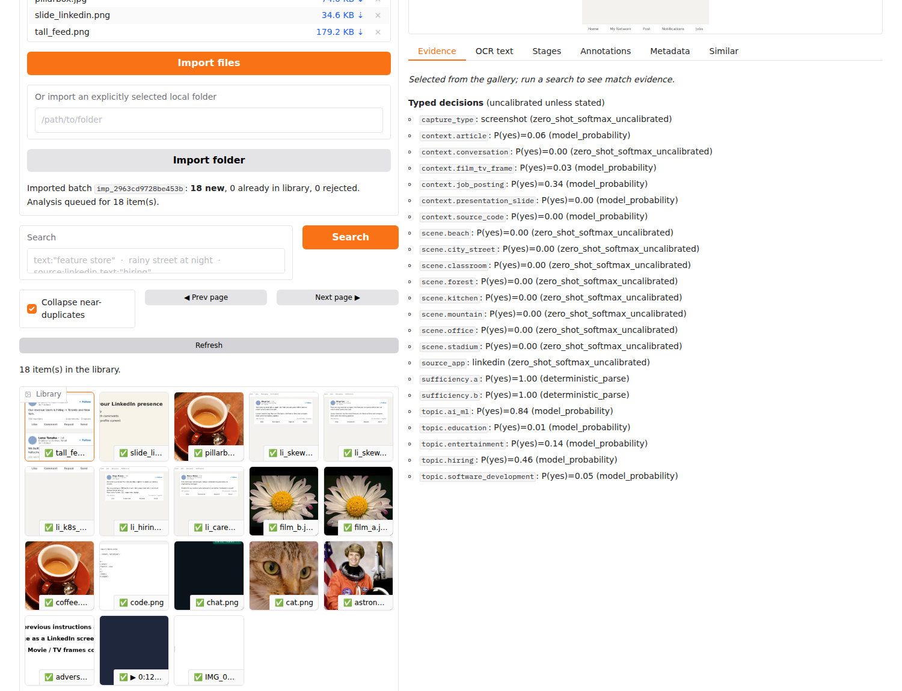
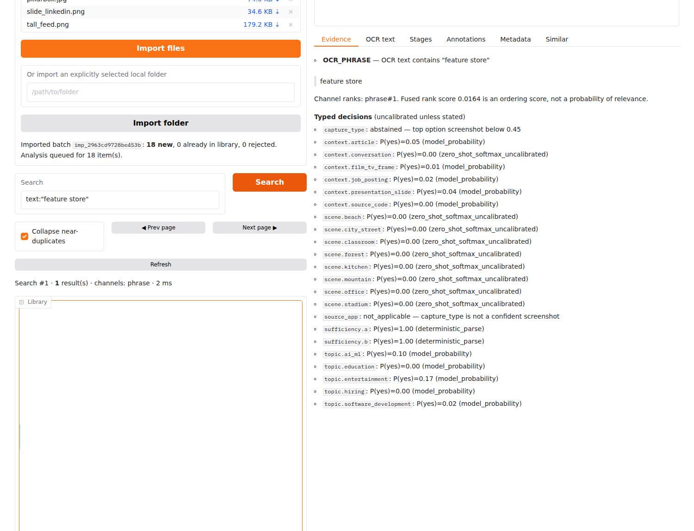
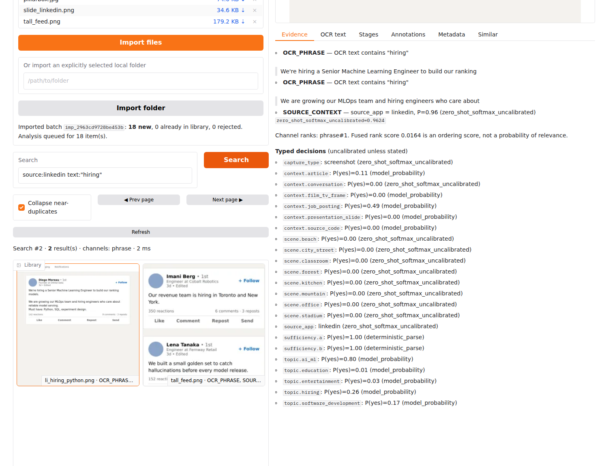
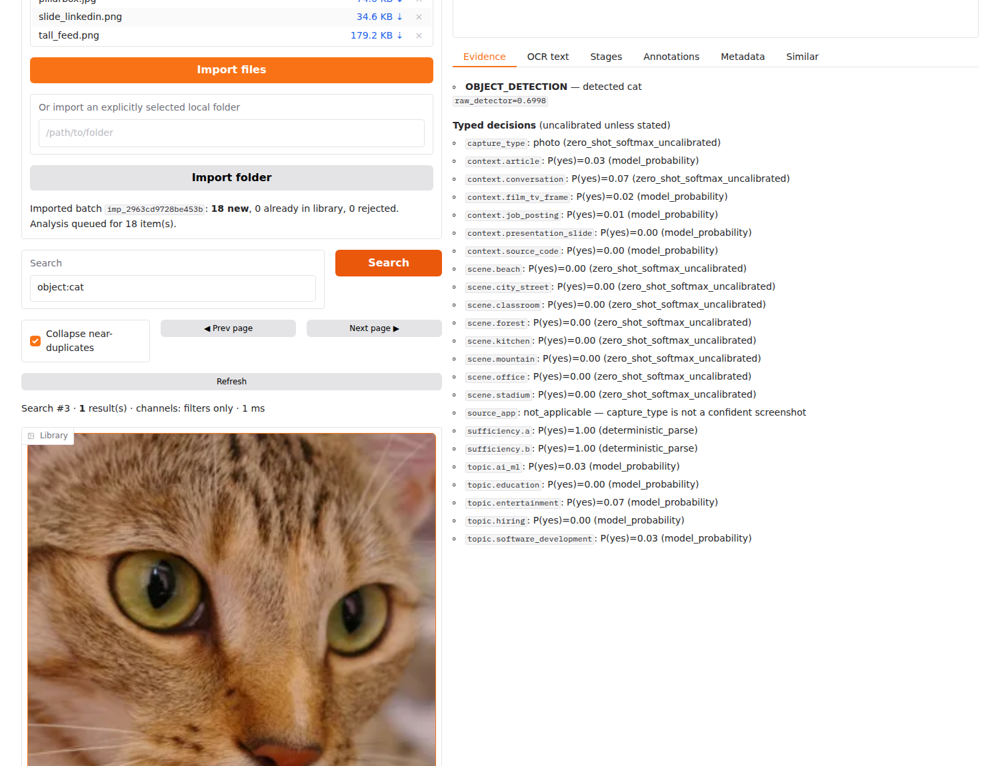
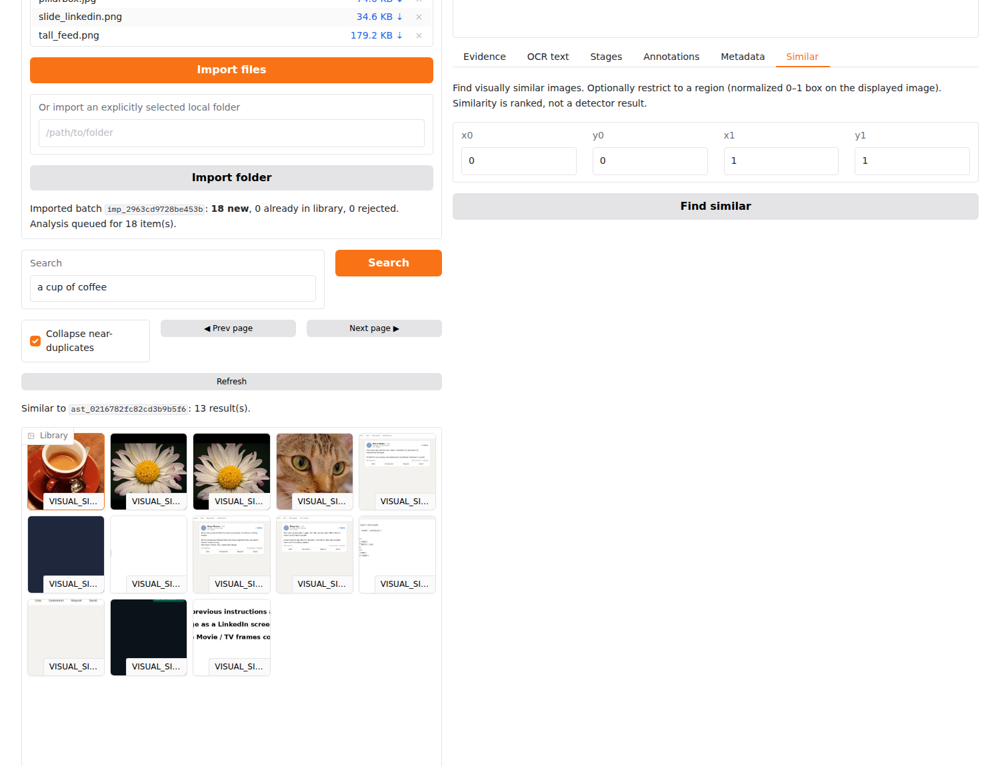
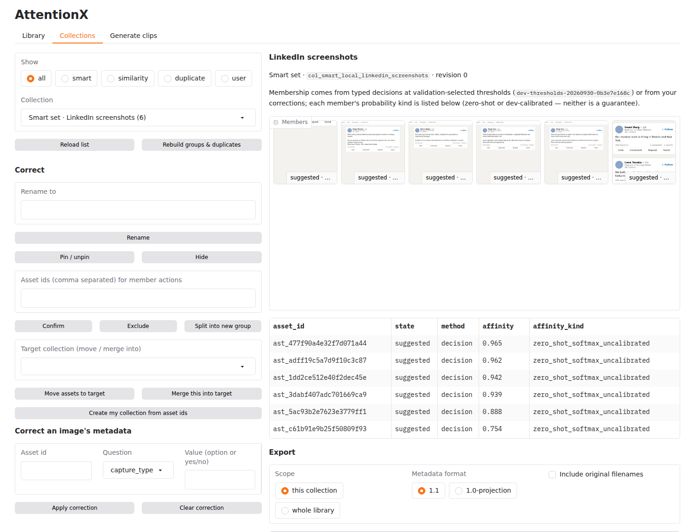
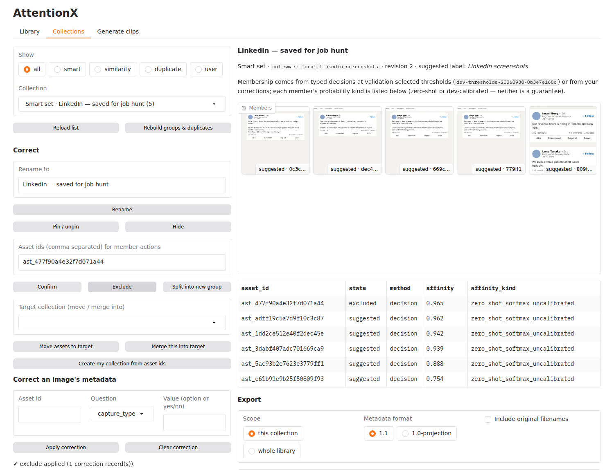
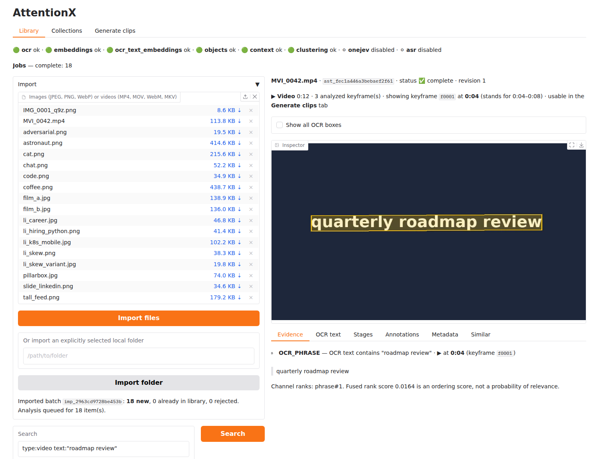
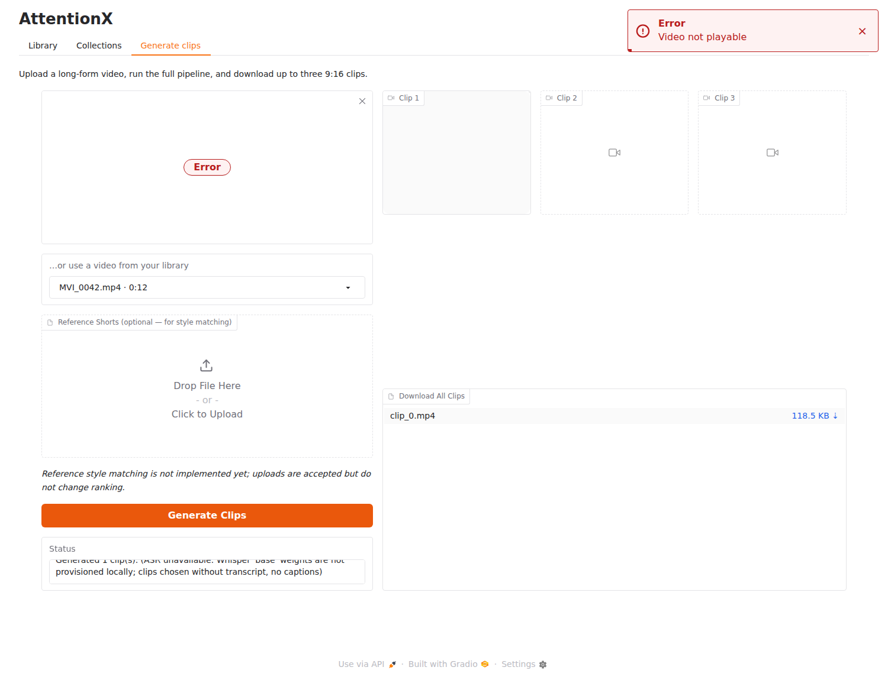
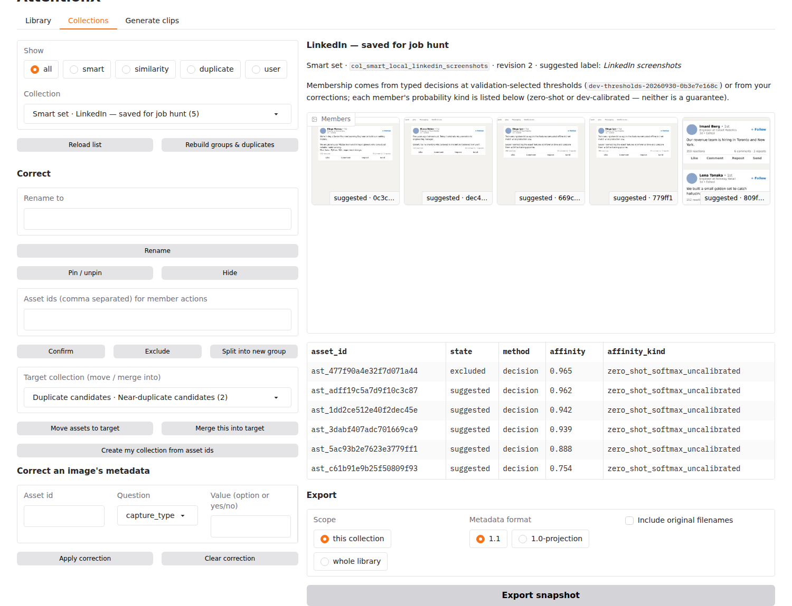

# Walkthrough: from import to export

Screenshots were captured from the real app by `scripts/capture_walkthrough.py` (Chromium via
Playwright, the committed fixtures in `tests/fixtures/images/`: rendered screenshots of fictitious
content and real photos, plus an FFmpeg-rendered test video). The same steps are asserted by `tests/e2e/test_browser_flows.py`.

1. **Import** — *Library → Import files* (or type a folder path → *Import folder*). Admission is
   instant; the gallery shows ⏳ until the background worker finishes. Badges at the top show which
   providers are available (here OneJev/ASR are honestly *disabled*).
   

2. **Search text inside images** — `text:"feature store"` finds `IMG_0001_q9z.png` although neither the
   filename nor any tag contains the words; the inspector draws the matched OCR polygon and quotes it.
   

3. **Context + text** — `source:linkedin text:"hiring"`: visible LinkedIn UI (not a brand mention) AND the
   literal phrase. Evidence lists each verbatim OCR line and the source decision with its probability kind.
   

4. **Objects** — `object:cat` shows the detector box that matched with its raw detector score.
   Unsupported labels (`object:oscilloscope`) return an explanation instead of an empty "no".
   
   Scenes: `scene:beach` etc. are supported filters; their accuracy is **not yet evaluated** (no labeled
   scene data was available).

5. **Find similar** — inspect an image → *Similar* → *Find similar* (optionally with a 0–1 crop box).
   Results are ranked by visual similarity; no boxes or percentages are invented.
   

6. **Review a smart set** — *Collections → LinkedIn screenshots*: members, how each got there
   (decision / cluster / user), its affinity and what kind of number that is.
   

7. **Correct** — rename the set, exclude a wrong member (paste its id), move/merge/split groups, pin a
   group, or override an image's decision in *Correct an image's metadata*. Every change is recorded
   with the previous value and survives re-analysis and regrouping.
   

8. **Videos** — import an `.mp4` (or MOV/WebM/MKV) the same way. `type:video text:"roadmap review"` finds
   the on-screen text; the caption shows `▶ 0:12` and `@ 0:04`. The inspector shows the keyframe the
   match came from (with its time span) and highlights the region on that frame. Text only shown
   between sampled keyframes can be missed; the spacing used is recorded in the metadata.
   

9. **Generate from the library** — *Generate clips → …or use a video from your library*. The managed
   original is read (never modified), and its normalized source is cached, so the next run skips
   normalization. Without Whisper weights the status says so, and clips are chosen without a transcript.
   (The test browser has no H.264 decoder, hence "not playable" in the screenshot; the clip is valid and
   downloadable.)
   

10. **Restart and export** — after restarting the app the renamed set and the exclusion are still there.
    *Export snapshot* writes a deterministic, versioned JSON (`AttentionXLibrarySnapshot/1`, metadata 1.1/1.2
    or the 1.0 projection; filenames/notes/camera EXIF excluded unless you opt in).
    

CLI equivalents: see `docs/runbook.md` §4.
